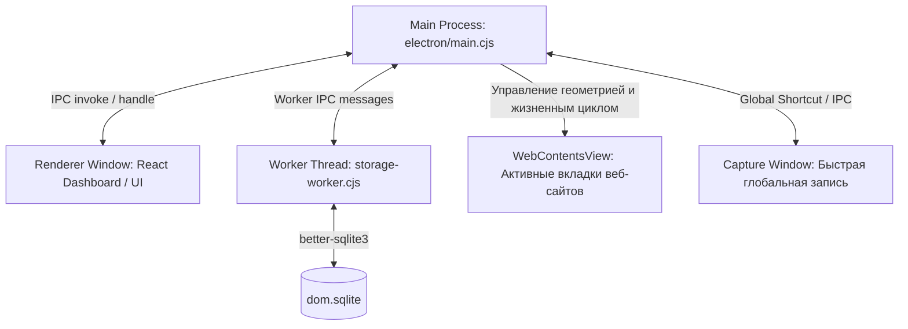
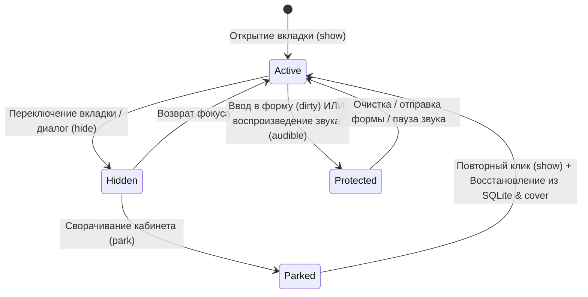

# Архитектура и техническое описание системы dombro

> **Назначение документа:** Полная техническая спецификация устройства проекта, моделей данных, процессов, жизненного цикла памяти, безопасности и интеграций. Служит единым источником правды (Single Source of Truth) для разработчиков и ИИ-ассистентов.

---

## 1. Обзор и стек технологий

**dombro** — это гибрид настольного веб-браузера и спокойного рабочего дашборда для Windows 11 (с архитектурным заделом под macOS), ориентированный на изоляцию рабочих контекстов («Кабинетов»), предотвращение утечек памяти и сохранение фокуса.

### Миссия и концепция Calm Tech (Снятие когнитивной нагрузки):
Продукт спроектирован специально для людей с высоким потреблением информации, испытывающих цифровую тревогу от десятков открытых вкладок и потерю концентрации:
* **Снятие тревожности:** в системе нет красных счетчиков («badges») непрочитанного, штрафов за перенос дел или бесконечных лент (Infinite Scroll). Дайджесты конечны, а остров внимания показывает не более одного сигнала за раз.
* **Чистый дизайн без мелких шрифтов:** просторная типографика Manrope, достаточный «воздух», отсутствие нечитаемых мелких кеглей (мельче 12px) и перегруженных таблиц.
* **Самоочевидный UI (Минимум текста инструкций):** интерфейс говорит физикой и расположением, не требуя обучающих простыней, туториалов и всплывающих подсказок.
* **Мягкая кинематика:** пружинные анимации без резких скачков и отскоков (FluidGroup с комфортным перетеканием `duration: .22`, затуханием на месте без рывков к выбранному табу при уходе курсора; устранение масштабирования `scale` окна и кнопок для предотвращения субпиксельного размытия текста; плавное проявление острова внимания через чистый `opacity` без агрессивного `blur` и скачков геометрии; CalmTooltip со стабильным якорением к элементу без дрожания за курсором и умеренной задержкой `200ms` / `100ms`), с полной поддержкой `prefers-reduced-motion`.

### Основной стек:
* **Среда исполнения:** Electron 41 (Node.js 22 runtime + движок Chromium).
* **Пользовательский интерфейс (UI):** React 19, TypeScript, Lucide React (иконки), Manrope (типографика).
* **Сборка и бандлинг:** Vite 6, `tsc` (строгая проверка типов), `electron-builder` (NSIS и Portable сборки под Windows).
* **Хранилище данных:** `better-sqlite3` с FTS5-полнотекстовым поиском, шифрование через `safeStorage` (Windows DPAPI / macOS Keychain).
* **Анимации и физика:** Motion (`motion/react`) с соблюдением стандарта доступности `prefers-reduced-motion`.
* **Тестирование:** Vitest 4, JSDOM, кастомные нативные тест-раннеры Electron (`tests/cabinet-native.cjs`, `scripts/test-storage.cjs`).

---

## 2. Архитектура процессов Electron

Приложение использует строгую многопроцессную архитектуру с полной изоляцией контекстов и отсутствием `nodeIntegration` в окнах рендеринга.



### 1. Главный процесс (`electron/main.cjs`)
* Управляет окнами (`mainWindow`, `captureWindow`, `splashWindow`), системным треем и глобальными горячими клавишами (`Ctrl+Shift+Space` на Windows, `Cmd+Shift+Space` на macOS). При повторном нажатии в активном окне записи переключает голосовой ввод (`capture:toggle-voice`).
* Инициализирует вспомогательные менеджеры: `BrowserManager` (браузерные вкладки), `Storage` (БД), `Vault` (пароли), `Gmail` (почта), `AI` (модели).
* Валидирует все IPC-запросы через хелпер `trustedHandle` (проверка источника отправителя на соответствие доверенному UI).

### 2. Процесс рендеринга (`src/`)
* Одностраничное приложение на React 19.
* Доступ к системным функциям получает исключительно через строго типизированный фасад `window.dom` ([`src/bridge.ts`](file:///d:/dev/tools/browser/src/bridge.ts)), предоставленный мостом контекста ([`electron/preload.cjs`](file:///d:/dev/tools/browser/electron/preload.cjs)).
* Полная изоляция: `contextIsolation: true`, `sandbox: true`, `nodeIntegration: false`.

### 3. Рабочий поток базы данных (`electron/storage-worker.cjs`)
* SQLite-операции вынесены в отдельный воркер, чтобы тяжелые транзакции и FTS5-поиск не блокировали UI-поток и IPC.
* Обеспечивает транзакционные мутации состояния через JSON-патчи.

### 4. Вкладки сайтов (`WebContentsView` через `electron/browser.cjs`)
* Сайты отображаются **не** через уязвимые `<webview>` теги и **не** через iframe, а через нативные `WebContentsView`, прикрепленные к главному окну.
* Каждая веб-страница изолирована в отдельной сессии Chromium (`persist:dom-browser`), очищается от Electron-сигнатур в User-Agent и защищается прелоадом [`electron/page-preload.cjs`](file:///d:/dev/tools/browser/electron/page-preload.cjs).

---

## 3. Модель памяти и жизненный цикл вкладок (Hibernation & Parking)

В отличие от стандартных браузеров, где десятки вкладок остаются в памяти до исчерпания системной RAM, в dombro реализована **детерминированная модель выгрузки неактивных пространств**.



### Защита от потери данных (`record.protected`)
Вкладка считается **защищённой** и гарантированно не выгружается из памяти в следующих случаях:
1. **Несохранённый ввод (`dirty: true`):** Прелоад [`electron/page-preload.cjs`](file:///d:/dev/tools/browser/electron/page-preload.cjs) перехватывает события `input` (текстовые поля, `textarea`, `contenteditable`) и `change` (выпадающие списки `select`, радио-кнопки, чекбоксы).
2. **Воспроизведение аудио/видео (`playing: true` или `audible: true`):**
   * Нативный уровень: `webContents.isCurrentlyAudible()` и события `media-started-playing`, `media-paused`, `audio-state-changed`.
   * DOM-уровень: опрос активных `<video>` и `<audio>` элементов.
   * Звонки Google Meet / WebRTC и фоновая музыка продолжают играть без прерывания.

### Механизм парковки (`BrowserManager.park`)
* При переключении или выходе из пространства ([`src/App.tsx:parkSpace`](file:///d:/dev/tools/browser/src/App.tsx)) вызывается `bridge.browser.park(tabIds)`.
* **Честный замер освобождённой памяти:** перед уничтожением нативных `WebContentsView` менеджер собирает `getOSProcessId()` выгружаемых вкладок, сопоставляет их с `app.getAppMetrics()` главного процесса, суммирует `memory.workingSetSize` (в КБ) и возвращает точное число `freedMB`.
* Для каждой незащищённой вкладки:
  1. Делается мгновенный скриншот (`capturePage()`), сжимается до 1000px и отправляется в кэш обложек `tabCovers`.
  2. Метаданные (URL, title, favicon, scrollY) сохраняются в SQLite.
  3. Нативный `WebContentsView` безопасно уничтожается, полностью освобождая память процесса Chromium.
* Защищённые вкладки остаются активными в фоновом режиме; пользователю выводится уведомление о количестве удержанных в памяти вкладок.

### Физика анимаций и Calm Motion (Тактильные анимации порядка)
1. **«Оригами-парковка» (`tabCovers` → `ResumeCard`):**
   * В момент вызова `parkSpace` сохранённые обложки страниц из `tabCovers` плавно складываются веером в стопку `ParkedCoversStack` на карточке «Продолжить работу» ([`src/ResumeCard.tsx`](file:///d:/dev/tools/browser/src/ResumeCard.tsx)).
   * Полноэкранный контейнер [`src/browser/NativePane.tsx`](file:///d:/dev/tools/browser/src/browser/NativePane.tsx) и миниатюры в стопке связаны через общий `layoutId={tab-cover-${spaceId}-${tabId}}` из `motion/react`.
   * Карточка «Продолжить» мягко пружинит при приёме стопки (`stiffness: 350, damping: 28`), сохраняя шрифт Manrope без `scale` для исключения субпиксельного размытия.
2. **«Выдох оперативки» (`AttentionIsland` + фоновая световая волна):**
   * При освобождении памяти Chromium по фоновому пейзажу дашборда запускается однократная мягкая радиальная световая волна (`.dashboard-relief-wave`, `opacity: 0 -> 0.35 -> 0` за 600 мс).
   * Верхний Остров внимания ([`src/AttentionIsland.tsx`](file:///d:/dev/tools/browser/src/AttentionIsland.tsx)) плавно проявляет капсулу `MemoryReliefSignal` с крутящимся барабаном цифр (`useSpring` + `useTransform`): «Кабинет на паузе · Освобождено X МБ / X.X ГБ ОЗУ».
3. **«Выдувание шума из головы» (Аппаратный SVG-фильтр растворения):**
   * В корень [`src/App.tsx`](file:///d:/dev/tools/browser/src/App.tsx) встроен аппаратный фильтр `CalmWindSvgFilter` (`#calm-wind-dissolve`) на базе `<feTurbulence>` и `<feDisplacementMap>`.
   * При очистке черновика в [`src/ScratchpadWidget.tsx`](file:///d:/dev/tools/browser/src/ScratchpadWidget.tsx) удаляемый текст мягко рассеивается по ветру вправо-вверх (`x: 26, y: -10, filter: url(#calm-wind-dissolve) blur(4px)`) за 280 мс.
   * При включённом `prefers-reduced-motion` фильтр автоматически отключается и заменяется на прямое затухание `opacity: 0` за 150 мс.
4. **Процедурный тактильный саунд-дизайн Calm Tech ([`src/sound.ts`](file:///d:/dev/tools/browser/src/sound.ts), спецификация [`docs/calm-sound-engine.md`](file:///d:/dev/tools/browser/docs/calm-sound-engine.md)):**
   * Исключение раздражающих цифровых писков и звонков (частоты выше 2500 Гц не используются).
   * Полный синтез на базе Chromium Web Audio API без внешних аудиофайлов.
   * Низкочастотный срез (Low-Pass на уровне 900–1800 Гц) и микро-джиттер высоты тона (±3%), чтобы звуки звучали матово, приглушённо и тактильно.
   * Поддержаны 4 базовых акустических паттерна: глухой деревянный щелчок `playWoodSnap` (смена магнитного силуэта и посадка карточки в сетку), шелест бумаги `playPaperFold` (складывание вкладок в карточку «Продолжить»), двухфазный тумблер `playCaptureToggle` (голосовой ввод Capture по Ctrl+Shift+Space) и мягкий выдох `playCalmExhale` (очистка заметок и появление капсулы освобождённой памяти в Острове внимания).
   * Мгновенное переключение в один клик в настройках с сохранением состояния в `localStorage`.

### Бесшовное пробуждение (Zero-Flicker Restoration)
* При повторном открытии выгруженной вкладки компонент [`src/browser/NativePane.tsx`](file:///d:/dev/tools/browser/src/browser/NativePane.tsx) мгновенно рендерит сохраненный снимок страницы (`.native-cover`), переданный через карту обложек `tabCovers`.
* Новый `WebContentsView` создается и загружает URL в фоне, не показывая пользователю белый экран или мигание пустого окна.

---

## 4. Хранилище данных и безопасность

### 1. Локальная база данных (`dom.sqlite`)
* Расположение: `%APPDATA%\dombro\dom.sqlite` (или `%APPDATA%\dombro-cabinet-pilot` в режиме пилота).
* Содержит единое состояние приложения `app` в сериализованном виде, а также таблицы полнотекстового индекса FTS5.
* Автоматическое создание снимка на старте (`dom.previous.sqlite`) и возможность ручной резервной копии (`dom.manual.sqlite`).

### 2. Защита секретов (`secrets.encrypted.json`)
* Ключи API (OpenAI, Anthropic), OAuth-токены Gmail и секретные адреса календарей iCal шифруются на уровне операционной системы через `safeStorage` (Windows Data Protection API / macOS Keychain).
* При недоступности системного шифрования сохранение секрета отклоняется.

### 3. Безопасность браузинга и совместимость с сервисами авторизации
* **Защита от блокировок Google Auth и Cloudflare Turnstile (Антидетект Chromium):**
  * В `electron/main.cjs` отключен флаг автоматизации Blink: `app.commandLine.appendSwitch('disable-blink-features', 'AutomationControlled')`. Это исключает детект `WebContentsView` как автоматизированного тестового драйвера.
  * В `electron/browser.cjs` для сессии браузера через `session.webRequest.onBeforeSendHeaders` перехватываются сетевые заголовки: `Sec-CH-UA` и `Sec-CH-UA-Full-Version-List` динамически заменяются на бренд `"Google Chrome"` с синхронизацией мажорной и полной версии Chromium (`process.versions.chrome`), а сигнатуры `Electron/...` вырезаются из `User-Agent`.
  * В `electron/page-preload.cjs` свойство `navigator.webdriver` переопределено на возврат `false` (через `Object.defineProperty`) как в изолированном контексте прелоада, так и внедрением скрипта в основной мир DOM страницы.
  * Резервный вход (OAuth Fallback): для сервисов с параноидальными блокировками в `BrowserPane.tsx` доступна кнопка «В браузере» (`onOpenExternal`), открывающая поток авторизации в системном браузере ОС.
* **Поддержка Widevine DRM (Медиапотоки Spotify, Netflix, Кинопоиск):**
  * В `electron/main.cjs` внедрено ожидание инициализации DRM-модулей `components.whenReady()` перед созданием окон, обеспечивающее совместимость со специализированной сборкой `@castlabs/electron-releases` и VMP-подписью Castlabs EVS.
* **Подпись релизов и обход экрана Windows SmartScreen:**
  * Документированы экономичные стратегии устранения синего экрана защиты: облачная подпись Azure Trusted Signing (~$9.99/мес.), публикация в Microsoft Store ($19 разово) и бесплатный сертификат SignPath.io для Open Source (детали в [`docs/prod-security-guide.md`](file:///d:/dev/tools/browser/docs/prod-security-guide.md)).
* **Запрет всплывающих окон:** `setWindowOpenHandler` отклоняет произвольное создание окон (`action: 'deny'`) и направляет ссылки в табы dombro.
* **Защита от перекрытий:** `MutationObserver` в UI отслеживает модальные окна, меню и слои drag-and-drop, вызывая `browser.block(true)` для блокировки кликов по нативным слоям.
* **Контроль прав:** системный обработчик `setPermissionRequestHandler` для камеры, микрофона, уведомлений и буфера обмена запрашивает явное подтверждение через UI ([`PermissionPrompt.tsx`](file:///d:/dev/tools/browser/src/browser/PermissionPrompt.tsx)).

---

## 5. Продуктовые концепции и пользовательские сценарии

```
┌─────────────────────────────────────────────────────────────┐
│                          ДАШБОРД                            │
│  ┌────────────────┐ ┌──────────────────┐ ┌───────────────┐  │
│  │ Мой день / План│ │Карточка «Продол- │ │   RSS-Выпуск  │  │
│  │ и Календарь    │ │жить» (контекст)  │ │   (без шума)  │  │
│  └────────────────┘ └──────────────────┘ └───────────────┘  │
│  ┌───────────────────────────────────────────────────────┐  │
│  │      КАБИНЕТЫ (Пространства без лишней иерархии)      │  │
│  │  [Логотип] [Презентация] [Исследование] [Личное]      │  │
│  └───────────────────────────────────────────────────────┘  │
└─────────────────────────────────────────────────────────────┘
                               ▲
           Явный вход в работу │ Возврат на главную
                               ▼
┌─────────────────────────────────────────────────────────────┐
│                      РЕЖИМ БРАУЗИНГА                        │
│  [Шапка: Остров внимания] [Переключатель Кабинета] [Стол]   │
│  [Вкладка 1] [Вкладка 2 (звук)] [Вкладка 3] [+]             │
│  ─────────────────────────────────────────────────────────  │
│  [Живой WebContentsView 1]  | [Панель материалов кабинета:  │
│  (или просмотр рядом)       |  локальные файлы .fig / .psd] │
└─────────────────────────────────────────────────────────────┘
```

### 1. Кабинеты (Spaces)
* Единица организации работы. Кабинет объединяет открытые вкладки, прикрепленные документы (файлы Windows) и следующий шаг.
* Не требует обязательного ведения канбан-досок или статусов: закрыл приложение — открыл, всё на месте.

### 2. Карточка «Продолжить» ([`ResumeCard.tsx`](file:///d:/dev/tools/browser/src/ResumeCard.tsx)) и модульная сетка Дашборда
* На главной странице гарантированно отображается в левом верхнем углу (строка 1) через функцию `activeOrRecentContinuation`. Даже если у пространства нет открытых вкладок или явного чекпоинта, карточка показывает статус готовности к работе («Пространство готово к работе») и открывает кабинет по клику.
* Запускает связанные локальные файлы в системных программах по умолчанию (через `shell.openPath`), восстанавливает живые вкладки и показывает следующий шаг.

### 2.1. Интерактивная модульная сетка и режим редактирования дашборда
* **Сетка дашборда (`.dashboard-grid`):** Единый 12-колоночный модульный грид с половинным шагом строк (`grid-template-columns: repeat(12, minmax(0, 1fr))`, `grid-auto-rows: 56px`, `gap: 18px`, `grid-auto-flow: row`), применяемый во всех режимах (`.custom-grid` в обычном просмотре и `.editing-grid` при редактировании). Для исключения хаотичных перестановок карточек при ресайзе внедрен детерминированный алгоритм вычисления колонок (`computeWidgetPositions` в `src/dashboard.ts`): карточки пакуются в виртуальные строки шириной до 12 колонок с явной привязкой `--widget-col-start` (`grid-column: var(--widget-col-start, auto) / span ...`). Это гарантирует предсказуемость колоночной структуры (первая карточка строки всегда жестко стартует с колонки 1, вторая — с колонки 7 и т.д.): уменьшение высоты правой карточки больше не приводит к перескоку левой нижней карточки в освободившуюся дыру справа. Устранено расхождение с устаревшим двухрядным `standard-grid` (где 2-я строка была зафиксирована на 304px, приводя к вертикальному переполнению до 608px+ и появлению скроллбара). Высота стандартного двухрядного набора карточек составляет ровно 574px (`4 × 56 + 3 × 18 = 278px` для карточек на 4 ряда, `6 × 56 + 5 × 18 = 426px` для карточки дня на 6 рядов), что гарантирует идеальное вертикальное вмещение без прыжков верстки при входе и выходе из режима редактирования. Дискретность ресайза удвоена по обоим измерениям: горизонтальный шаг составляет ~101.5px (вместо 203px), а базовый вертикальный ряд равен 56px (2 ряда с учетом зазора дают ровно 130px: `2 × 56 + 18 = 130px`). Раскладки автоматически мигрируют (`gridVersion: 2`), масштабируя старые сохранённые `colSpan` и `rowSpan` в 2 раза без потери пропорций.
* **Тактильный ресайз карточек (Super-smooth Edge & Corner Resizing, [`src/useDashboardDrag.ts`](file:///d:/dev/tools/browser/src/useDashboardDrag.ts)):**
  * Захват за все края и угол: левый край (`.widget-edge-left`, курсор `ew-resize`), правый край (`.widget-edge-right`, курсор `ew-resize`), нижний край (`.widget-edge-bottom`, курсор `ns-resize`) и правый нижний угол (`.widget-corner-handle`, курсор `nwse-resize`). Тонкие успокаивающие hover-индикаторы (`rgba(72, 115, 70, 0.75)`). При ресайзе за левый край карточка динамически компенсирует смещение (`translateX(resizeShiftX)`), сохраняя правую границу на месте и адаптируя соседа слева.
  * 1-to-1 непрерывное пиксельное следование: во время движения мыши карточка меняет размеры непрерывно в пикселях (`transition: none !important`), исключая рывки и прыжки верстки.
  * **Направленная изоляция и резиновый упор (Rubber-band Resistance):** при жесте ресайза за правый край или угол крайней правой карточки (`edge === 'right' || edge === 'corner'`) запрещено сжимать левого соседа или смещать левую границу виджета. Если свободное место в строке исчерпано, ширина карточки мягко упирается с суб-линейным тактильным сопротивлением (`Math.pow(over, 0.55) * 1.5`), а при отпускании плавно возвращается в размер модульной сетки без деформации строки.
  * Магнитный силуэт приземления (Ghost Snap Outline, `.widget-ghost-snap-outline`): полупрозрачный контур с мягким переходом (150 мс) и бейджем размерности (`${colSpan} × ${rowSpan}`), показывающий будущую ячейку модульной сетки (для левого ресайза позиционируется от правого края `.ghost-from-right`).
  * Плавное приземление (Snap Landing): при `pointerup` карточка плавно анимируется (`.is-snapping`, `transition: width 0.22s cubic-bezier(0.2, 0, 0, 1), height 0.22s`) из текущих пикселей в размер целевой ячейки, после чего фиксируются `colSpan` и `rowSpan` в `WidgetConfig`, а инлайн-пиксели очищаются. Полная поддержка `prefers-reduced-motion` (мгновенная фиксация без задержек).
* **Режим редактирования (Canvas Edit Mode) и Drag & Drop:**
  * **Единый плавающий слот управления (`.dashboard-floating-controls`):**
    * Устранена пустая горизонтальная строка между строкой поиска и карточками (`.calm-heading`), что позволило подтянуть дашборд вверх без паразитных зазоров.
    * В обычном режиме справа от карточек (в 14px от правого края сетки: `left: calc(100% + 14px)`) парит лаконичная круглая стеклянная кнопка настроек 38×38px с иконкой `SlidersHorizontal` (`.edit-fab-toggle`).
    * **Единый диаметр 38px (Anti-bloat):** все кнопки управления (`.edit-fab`, `.edit-fab-toggle`, `.edit-fab-cancel`, `.edit-fab-add`, `.edit-fab-done`, `.edit-fab-presets`) приведены к строго одинаковому размеру 38×38px с компактным шагом `gap: 8px`. Исключён разнобой диаметров и рывки размеров при раскрытии панели.
    * **UX пространственной фиксации отмены (In-place Close Cross):** при клике на кнопку настроек в позиции №1 (ровно в той же точке, где находился курсор пользователя) оказывается крестик отмены/закрытия (`.edit-fab-cancel` с `<X size={17} />`). Пользователь может мгновенно закрыть настройки повторным кликом без перемещения курсора. При наведении применён спокойный шалфейный тон (`#1c3624` на белом фоне) без тревожных красных цветов.
    * **Каскадное раскрытие и отделение пресетов:** кнопка добавления виджета (`+`) и сохранения (`Check`) плавно спускаются каскадом вниз (`@keyframes fab-cascade-in`), а кнопка пресетов (`BookmarkPlus`) опускается на самый низ панели и визуально отделяется деликатным горизонтальным разделителем (`.dashboard-floating-divider`, 20×1px). При выходе панель плавно сворачивается обратно в одиночную кнопку `SlidersHorizontal`.
    * Кнопки расположены вплотную к сетке карточек (ровно 14px зазора на экранах любой ширины), а на экранах `< 1340px` мягко прижимаются к правому краю окна без выхода за пределы экрана. На мобильных экранах (`< 760px`) панель трансформируется в нижний горизонтальный ряд.
  * **Вертикальный скролл и градиентное размытие краёв (Vertical Rail Mask, по аналогии с «Все пространства»):**
    * Высота каркаса `.page-wrap` оптимизирована до `min(890px, calc(100dvh - 54px))`, а вертикальное позиционирование переведено в `align-items: flex-start; justify-content: center;` с верхним отступом `margin: clamp(24px, 4.2vh, 46px) auto 0;`.
    * Весь дашборд подтянут выше на ~100px в верхнюю зону неба без коллизий с кнопками заголовка окна Windows, а рабочая область `.hub-content` расширена до 614px (при 1080p).
    * Стандартный двухрядный шаг горизонтальной сетки карточек (высота двух 4-рядных карточек с зазором 18px составляет 574px + 20px паддинга = 594px) полностью и гарантированно умещается в экран 1920×1080 без появления вертикального скроллбара и размытия.
    * Сетка обёрнута в контейнер `.dashboard-scroll-wrap` с `height: 100%; max-height: 100%;` и лаконичным тонким скроллбаром 6px в спокойных тонах Calm Tech (`rgba(48, 79, 60, 0.28)`). Скроллбар и градиентная маска плавно активируются только при наличии 3-го ряда карточек или их сильном увеличении пользователем.
    * В режиме редактирования или при активном перетаскивании/ресайзе карточек маска гарантированно отключается (`mask-image: none !important`), что исключает любое клиппирование или размытие перемещаемых карточек.
  * **Защита от обрезки (Zero-clipping):** контейнеры `.hub-content:has(.calm-home)` и `.dashboard-home` переведены в `overflow: visible !important`, а перетаскиваемой карточке задан `z-index: 1000 !important`, что гарантирует полное отсутствие обрезки слева, справа, сверху или снизу при перемещении.
  * **Доступность всех карточек:** устранена обрезка ручек ресайза, дочерние интерактивные элементы в режиме редактирования изолированы (`pointer-events: none`), а ручки и кнопка удаления выведены на передний план (`z-index: 50 !important`). Карточку можно захватить за любую точку её поверхности.
  * **Кнопки удаления (`.widget-remove-btn`):** расположены строго внутри карточки (`top: 10px; right: 10px;`), размер увеличен до комфортного хитбокса 28×28px (иконка 15px) с мягким полупрозрачным фоном и `backdrop-filter: blur(8px)`.
  * **Плавающее превью и кинематика (Floating Drag Preview):** перетаскиваемая карточка перемещается строго горизонтально без наклона (убран `rotate`, используется только лёгкий подъём `scale(1.02)` и глубокая мягкая тень), а на её месте в сетке отображается силуэт-плейсхолдер.
  * **Стабильность координат и защита от улетания:** при смене слотов сетки вычисляется истинное положение слота за вычетом активного смещения (`currentSlotLeft = dragRect.left - dx`), что гарантирует нулевой джиттер и предотвращает улетание карточки за пределы экрана.
  * **Плавное приземление (Landing animation):** при отпускании карточка мягко опускается в слот за 220 мс (`transition: transform 0.22s cubic-bezier(0.2, 0, 0, 1)`).
* **Адаптация соседних карточек в строке ([`src/dashboard.ts:adaptRowSpans`](file:///d:/dev/tools/browser/src/dashboard.ts)):**
  * **Спокойный ресайз без самопроизвольного расширения соседей:** при уменьшении ширины карточки (как правой, так и левой) соседние карточки в строке **не увеличиваются сами** и не заполняют экран, сохраняя свои исходные размеры. Освободившиеся колонки остаются свободным пространством справа в строке.
  * **Защита правого края и удержание пропорций:** при увеличении ширины левой карточки вправо соседняя правая карточка сохраняет свой размер, пока в строке есть свободные колонки; если же правая карточка уже упёрлась в правый край дашборда (или свободное место исчерпано), правая карточка плавно уменьшается до своего допустимого минимума (`minCol`).
  * **Изоляция краёв:** правая карточка при попытке растянуть её за правый край дашборда не может выйти за пределы 12 колонок и не сжимает соседа слева (резиново сопротивляется). Сжатие левого соседа возможно только при явном перетаскивании левой ручки карточки влево (`edge: 'left'`).
* **Карточки Calm Tech и гибкая высота:**
  * **«Продолжить» ([`src/ResumeCard.tsx`](file:///d:/dev/tools/browser/src/ResumeCard.tsx)):** ограничение минимальной высоты снижено до 1 строки (`minRow: 1`). При сжатии до `rowSpan <= 2` (соответствует ≤ 130px) карточка переходит в компактный однострочный режим (`is-compact-row`) с размещением названия пространства, индикаторов вкладок/документов, заголовка и кнопки перехода в одну линию. При малых габаритах (`rowSpan <= 4`, `colSpan <= 5` или размер `S`) активируется класс `.is-small-card` с оптимизированными паддингами (`16px 20px 14px`), уменьшенной кнопкой (36px) и гарантированным сохранением кнопки перехода строго внутри карточки с комфортным зазором.
  * **«Заметки / Черновик» ([`src/ScratchpadWidget.tsx`](file:///d:/dev/tools/browser/src/ScratchpadWidget.tsx)):** постоянный блокнот на главном экране с непрерывным автосохранением в SQLite (`scratchpadNote`), поддержкой списков задач и кнопкой быстрого превращения строки в дело.
  * **«Почитать» (ранее «Чтение на потом», [`src/ReadingShelfWidget.tsx`](file:///d:/dev/tools/browser/src/ReadingShelfWidget.tsx)):** полка отложенных статей и ссылок из пространств с расчетом времени чтения, быстрым переходом и отметкой «прочитано». Для исключения поломок вёрстки заголовок сокращён до одного слова «Почитать», нижний пагинатор скрывается при `<= 1` статье, устранено горизонтальное переполнение (`overflow-x: hidden`), а при узкой ширине (`colSpan <= 5`, класс `.is-small-card`) включается компактный вид с одной строкой метаданных (`{domain} · {readMins} м`) без лишней иконки часов.
  * **«Подробная погода» ([`src/WeatherWidget.tsx`](file:///d:/dev/tools/browser/src/WeatherWidget.tsx)):** подробная метеокарточка на базе открытого API Open-Meteo без внешних API-ключей. Отображает текущую температуру, состояние неба, «ощущается как», влажность, скорость ветра (м/с) и осадки. Включает прогноз на 5–7 дней и селектор городов (Уфа, Москва, Санкт-Петербург, Казань, Екатеринбург, Новосибирск, Сочи) с кэшированием в localStorage и кнопкой быстрого перехода к пробкам.
  * **«Карты и дорожная обстановка» ([`src/MapWidget.tsx`](file:///d:/dev/tools/browser/src/MapWidget.tsx)):** встроенная интерактивная карточка с поддержкой Яндекс Карт и Google Maps. Позволяет мгновенно переключать провайдеров, активировать слой дорожных заторов («Пробки»), искать города/адреса и открывать карту в отдельной вкладке без потери рабочего контекста.
  * **«Забота и привычки» ([`src/HabitsWidget.tsx`](file:///d:/dev/tools/browser/src/HabitsWidget.tsx)):** спокойная карточка микро-рутин и физического баланса для снижения цифровой утомляемости. Включает:
    1. **Водный баланс:** интерактивный трекер стаканов воды (цель 8 ст.) с органическим процедурным звуком капли (`sound.playWaterDrop()`).
    2. **Отдых для глаз:** правило 20-20-20 (каждые 20 минут смотреть вдаль на 20 секунд).
    3. **Осознанное дыхание:** интерактивный 60-секундный таймер дыхания 4-4-4 (вдох, задержка, выдох) с визуальным успокаивающим кругом и звуком выдоха (`sound.playCalmExhale()`).
    4. **Разминка и осанка:** напоминание расправить плечи и потянуться.
    5. **Свои привычки:** возможность создавать собственные микро-рутины (счётчик или галочка).
    6. **Calm Tech суточный сброс:** детерминированный переход дат без штрафных красных бейджей, стрик-таймеров и чувства вины.

### 2.2. Стандарты дизайн-системы карточек (dombro UI Kit)
Для исключения визуального шума, «мета-текста» (интерфейса, разговаривающего сам с собой) и обеспечения спокойного восприятия (Calm Tech) все виджеты дашборда подчинены единому стандарту UI Kit:

1. **Единая геометрия шапки (Header):**
   * Строго одна верхняя строка высотой 28px с внешними отступами 20px от краёв карточки.
   * Слева: лаконичное название виджета строго в одно слово («Дела», «Почитать», «Почта», «Заметки»).
   * Справа: максимум 1 иконка действия (`+` или `⋯`).
   * В карточке возобновления (`ResumeCard`) шапкой служит название самого Кабинета с иконкой папки и меню `⋯`, восстанавливая узнаваемость рабочего контекста.
2. **Типографическая шкала Manrope (3 уровня):**
   * **Уровень 1 (Заголовок / Фокус):** 18px SemiBold (`#1C241E`).
   * **Уровень 2 (Тело / Задача / Статья):** 14px Medium (`#2C362E`).
   * **Уровень 3 (Метаданные / Время / Домен / Счётчик):** 12px Regular (приглушённый серо-зелёный `rgba(44, 54, 46, 0.55)`). Никакой текст не опускается ниже 12px (согласно архитектурным правилам).
3. **Иерархия цветовых акцентов и кнопок:**
   * Залитая тёмно-зелёная акцентная кнопка (`#2F4F3E`) строго **одна на весь экран** — кнопка «Продолжить →» в `ResumeCard`.
   * Все прочие кнопки внутри карточек оформляются как прозрачные (ghost) или мягкие полупрозрачные капсулы, не создающие конкурирующих темных пятен.
4. **Ранжирование карточек по ролям:**
   * **Hero-карточка («Продолжить»):** главный фокус экрана. Крупный заголовок Кабинета, подстрочник активных материалов (`{domain} · ещё N вкладок`), веер миниатюр сохранённых страниц (`tabCovers` / `ParkedCoversStack`) в центре и единственная залитая кнопка.
   * **Utility-карточки («Дела», «Почитать», «Почта», «Заметки», «Забота и привычки»):** чистый воздух, списки контента без инструкций и дублирующих надписей.
5. **Хирургическая чистка карточки «Дела» ([`src/Home.tsx`](file:///d:/dev/tools/browser/src/Home.tsx)):**
   * Устранена путаница двух параллельных переключателей времени: блок «День | Неделя | Месяц» удален с главного экрана.
   * Верхняя строка: слева переключатели «Сегодня» и «Завтра»; справа — компактная иконка календаря `[ 📅 ]` (вызывает модальную сетку недели/месяца) и кнопка добавления `+`.
   * Устранено дублирование кнопки «Добавить дело +»: при пустом списке текст «На этот день нет дел — нажмите, чтобы записать…» служит интерактивным кликабельным плейсхолдером.
   * Мягкий возврат хвостов: если на сегодня дел нет (0), но остались дела с прошлых дней, карточка отображает их приглушённым списком с быстрой кнопкой переноса `→ На сегодня` в 1 клик.
   * Убран перегруженный подвал «Сохранённое» (исключены дублирующий счетчик чтения и пустые «События 0»); оставлена единая лаконичная плашка `💭 Мысли без даты · {count}`.
6. **Оптимизация карточки «Почта» ([`src/FeedWidgets.tsx`](file:///d:/dev/tools/browser/src/FeedWidgets.tsx)):**
   * При отсутствии подключенного почтового ящика устранены дублирующиеся надписи («Нет подключённых аккаунтов» и кнопка в шапке). Выводится спокойный заголовок «Почта» и единственная аккуратная капсула «Подключить Gmail →».
7. **Автоматическое наименование и лимитирование полосы пространств ([`src/cabinetModel.ts`](file:///d:/dev/tools/browser/src/cabinetModel.ts), [`src/App.tsx`](file:///d:/dev/tools/browser/src/App.tsx)):**
   * Устранено накопление одинаковых названий «Поток: 24 сент. × 7 раз». Функция `formatSpaceDisplayName` извлекает домен или заголовок первой открытой вкладки и формирует осмысленное имя (например, `Поток · VK`, `Поток · Figma`, `Поток · YouTube`), сохраняя при этом пользовательские ручные имена.
   * Полоса вкладок в шапке отображает до 4 наиболее актуальных пространств с гарантированным включением активного кабинета, пряча остальные под кнопку «Все пространства».

### 2.3. Готовые и пользовательские пресеты дашборда ([`src/dashboard.ts`](file:///d:/dev/tools/browser/src/dashboard.ts), [`src/DashboardSettings.tsx`](file:///d:/dev/tools/browser/src/DashboardSettings.tsx))
* **Встроенные готовые пресеты (`builtinDashboardPresets`):**
  1. **«Спокойный (Фокус)» (`calm`):** абсолютная тишина и концентрация без отвлекающих новостных лент и почты. Содержит только карточки «Продолжить», «Фокус» (дзен-таймер), «Дела и календарь» и «Заметки».
  2. **«Рабочий (Кокпит)» (`work`):** режим максимальной продуктивности для насыщенного рабочего дня. Включает дела, почту Gmail, пространства проектов, RSS-дайджест, продолжение работы и погоду.
  3. **«Обзор (Стандартный)» (`overview`):** сбалансированный набор для ежедневного использования (продолжение работы, дела на день, дайджест).
  4. **«Город и день» (`city`):** контекстный городской сетап с подробной погодой, интерактивными картами/пробками, делами и полкой чтения на потом.
  5. **«Баланс и ритуалы» (`balance`):** забота о здоровье и микро-рутинах (водный баланс, дыхание, разминка, дзен-фокус, дела и заметки).
* **Скрытие пресетов в настройки и единый язык дизайна (Settings-Harmonized Design):**
  * Полоса пресетов убрана с главного экрана дашборда, чтобы не перегружать первый экран и не отвлекать пользователя.
  * Управление пресетами (выбор, сохранение текущего вида как `DashboardCustomPreset`, удаление) аккуратно размещено во вкладке «Пресеты» диалога настроек дашборда ([`DashboardSettings.tsx`](file:///d:/dev/tools/browser/src/DashboardSettings.tsx)), доступной через правую кнопку настроек и кнопку в режиме редактирования сетки.
  * **Визуальная гармония с общими настройками:** дизайн вкладки пресетов приведен к стандарту карточек `.settings-card` (`.preset-group-card`). Пресеты снабжены иконками-аватарами (36×36px), тяжёлые тёмные кнопки «Применить» заменены на спокойные кнопки выбора `.soft-button` с интерактивным кликом по всей строке. Активный пресет деликатно подсвечивается шалфейным тоном с бейджем `.preset-active-badge` («✓ Активен»). Форма создания пользовательского пресета вынесена в отдельную чистую карточку `.preset-create-card` без визуального шума и двойных рамок.
  * Все пользовательские пресеты транзакционно сохраняются в SQLite.

### 2.4. Поиск, омнибокс и навигация по пространствам
* **Главный омнибокс (`.calm-omnibox`):** подключен движок Google-саджестов с дебаунсом 150 мс (`bridge.fetchSuggestions`). Интегрирован с автодополнением открытых вкладок, закладок пространств и истории посещений. Поддерживает клавиатурную навигацию (стрелки вверх/вниз, Enter, Escape).
* **Кнопка поиска по пространствам (`.chrome-space-search`):** вынесена в таб-бар пространств справа от кнопки добавления (`[+] [🔍]`) и привязана к шорткату `Ctrl+K`. Открывает `ContextSearch` для мгновенной фильтрации кабинетов, заметок и материалов без визуального шума в браузерной строке.

### 2.5. Интеграция с окнами сторонних программ Windows ([`electron/os-windows.cjs`](file:///d:/dev/tools/browser/electron/os-windows.cjs), спецификация в [`docs/os-windows.md`](file:///d:/dev/tools/browser/docs/os-windows.md))
* **Концепция Calm Tech Window Management:** в отличие от непредсказуемой фоновой «автосцепки», привязка внешних программ (Photoshop, Illustrator, Figma, VS Code) выполняется строго по явному выбору пользователя через меню материалов панели Кабинета («+ Открытое окно», компонент [`OpenWindowPickerModal.tsx`](file:///d:/dev/tools/browser/src/browser/OpenWindowPickerModal.tsx)).
* **Легковесный FFI на koffi:** прямое обращение к Win32 API (`user32.dll`, `kernel32.dll`, `dwmapi.dll`) без уязвимых и тяжелых C++ аддонов node-gyp.
* **Фильтрация фантомных окон:** многоуровневое отсечение фоновых UWP хостов через `DwmGetWindowAttribute` (`DWMWA_CLOAKED`), исключение тулбаров `WS_EX_TOOLWINDOW` и окон чужих виртуальных рабочих столов Windows 11.
* **Безопасная парковка и продолжение:** при парковке Кабинета (`parkSpace`) связанные окна сворачиваются (`SW_MINIMIZE`). При клике «Продолжить» на карточке [`ResumeCard.tsx`](file:///d:/dev/tools/browser/src/ResumeCard.tsx) окна поднимаются на экран (`SW_RESTORE`) без потери статуса Foreground Process. Если окно было закрыто, dombro мягко запускает исполняемый файл заново по сохранённому пути `target`.

### 3. Интеграции без перегруза
* **Календарь:** Парсинг ICS/Webcal с поддержкой часовых поясов, VTIMEZONE, исключений и повторяющихся событий.
* **Почта (Gmail):** Desktop OAuth с PKCE, scope `gmail.readonly`. Сохраняет только заголовки и сниппеты (до 500 писем на аккаунт), локальный индекс.
* **Новости:** RSS/Atom выпуски (до 30 материалов в день, сохранение истории). Нет бесконечной ленты: прочитал выпуск — закрыл.
* **ИИ (Облачный):** OpenAI Responses и Anthropic Messages. Работает только по явному вызову пользователем; модель получает только одобренный контекст (выделенный текст, сниппеты).
* **Голосовой ввод и быстрое планирование (Push-to-Talk) ([`src/voice.ts`](file:///d:/dev/tools/browser/src/voice.ts), [`src/Capture.tsx`](file:///d:/dev/tools/browser/src/Capture.tsx)):**
  * Спокойная диктовка мыслей и напоминаний без постоянного фонового прослушивания: микрофон активен строго во время записи (0% фоновой нагрузки CPU, микрофон в ОС полностью освобождается).
  * Гибридный движок: браузерный Web Speech API + защищённый вызов Whisper API через IPC `ai:transcribe` в `electron/ai.cjs` при наличии ключа в `Vault`.
  * Автоматический парсинг естественного языка через [`src/reminders.ts:parseCapture`](file:///d:/dev/tools/browser/src/reminders.ts) (извлекает дату и время фразы «через 20 минут», «завтра в 14:00» без обращения к LLM).
  * Спокойный предпросмотр результата в диалоге с возможностью сохранения по Enter или редактирования.

---

## 6. Встроенный AdBlock и нативные расширения (Built-in Superpowers)

Вместо уязвимых и прожорливых сторонних расширений из Chrome Web Store в dombro встроены нативные суперсилы, глубоко интегрированные в ядро Electron и интерфейс:

### 1. Собственный AdBlock и Anti-Cookie (`electron/adblock.cjs`)
* **Движок:** `@ghostery/adblocker-electron` (uBlock Origin и EasyList совместимый).
* **Списки фильтрации:** EasyList, EasyPrivacy, Peter Lowe, RU AdList, EasyList Cookie List, uBlock Origin Annoyances.
* **Производительность и кэширование:** Сериализованный бинарный кэш правил (`userData/adblock-cache.bin`) восстанавливается на старте за **< 40 мс**.
* **Сетевая и косметическая фильтрация:** Блокирует трекеры и баннеры до обращения к сети через `onBeforeRequest`, скрывает пустые блоки через CSS-инъекции в `onInjectCosmeticFilters`.
* **Белый список и настройки:** Хранятся в `userData/adblock-settings.json`. Выключение на сайте в 1 клик через `AdblockShield` переводит домен в белый список без перезапуска движка.
* **Calm Tech UX:** Щит `[ 🛡️ ]` в Omnibox отображает спокойный контур без красных бейджей; при клике открывает поповер со статусом, счетчиком скрытых элементов и тумблером для текущего хоста.

### 2. Режим чистого чтения (`electron/reader.cjs` и `src/browser/ReaderView.tsx`)
* **Движок:** `@mozilla/readability` и `jsdom`.
* **Контекстная видимость:** Кнопка книги `[ 📖 ]` появляется в строке только при детекции статьи (проверка в `page-preload.cjs`).
* **Чтение в стиле книги:** Полноэкранный холст с крупным Manrope шрифтом (18-20px), оценкой времени чтения, настройкой размера шрифта и четырьмя спокойными темами (Светлая, Сепия, Бумага, Ночь). Исходное состояние и скролл веб-страницы сохраняются.

### 3. Умная тёмная тема для сайтов (`darkreader`)
* Динамически анализирует CSS страницы и генерирует высококонтрастную мягкую инверсию без искажения цветов изображений.
* Может быть включена принудительно для конкретного домена через поповер Щита.

### 5. Полоса вкладок пространств (Chrome-like Tab Strip)
* **Полнота списка вкладок:** Все созданные и незаархивированные рабочие пространства (`state.spaces.filter(space => !space.archivedAt && space.kind !== 'web')`) непрерывно отображаются в полосе вкладок `chrome-spaces-viewport` / `chrome-spaces-track` в порядке их создания или пользовательской сортировки. Искусственные ограничения (скрытие неприкрепленных табов или лимит в 3 вкладки) устранены.
* **Добавление вправо:** При создании новых пространств вкладки последовательно добавляются вправо, занимая ширину строки.
* **Навигация стрелками при переполнении:** Когда длина табов превышает доступную ширину строки (`scrollWidth > clientWidth`), автоматически активируются лаконичные кнопки прокрутки влево и вправо (`.chrome-spaces-scroll-arrows`) по аналогии с Chrome:
  - Плавная прокрутка на комфортный шаг (`step = 200px`) с уважением настройки `prefers-reduced-motion`.
  - Поддержка зажатия кнопки (hold-to-scroll): плавный непрерывный скролл при удержании стрелки мыши/тача.
  - Поддержка горизонтальной прокрутки колесиком мыши (с автоматическим преобразованием вертикального скролла мыши).
  - Мягкий градиентный mask-fade по краям (`has-before`, `has-after`) сигнализирует о наличии скрытых табов.
* **Автоматическое позиционирование:** При переключении пространства или создании нового активная вкладка автоматически плавно прокручивается в область видимости (`scrollIntoView`).
* **Закрепленные действия:** Кнопки «Все пространства», «+» (Создать пространство) и поиск по пространствам (`Ctrl+K`) сгруппированы в блоке действий справа (`.chrome-spaces-actions`), оставаясь доступными в один клик независимо от текущей позиции прокрутки.

---

## 7. Карта файлов кодовой базы

| Путь к файлу | Назначение |
| :--- | :--- |
| [`electron/main.cjs`](file:///d:/dev/tools/browser/electron/main.cjs) | Точка входа Electron: окна, трей, глобальные шорткаты, маршрутизация IPC. |
| [`electron/browser.cjs`](file:///d:/dev/tools/browser/electron/browser.cjs) | Менеджер нативных WebContentsView: геометрия, аудио-детекция, парковка, права. |
| [`electron/adblock.cjs`](file:///d:/dev/tools/browser/electron/adblock.cjs) | Ядро блокировки рекламы и трекеров: кэширование, белый список, статистика. |
| [`electron/os-windows.cjs`](file:///d:/dev/tools/browser/electron/os-windows.cjs) | Наблюдатель за окнами Windows: Win32 FFI через koffi, перечисление, сворачивание и фокус окон. |
| [`electron/reader.cjs`](file:///d:/dev/tools/browser/electron/reader.cjs) | Парсинг статей через Readability и управление темами DarkReader. |
| [`electron/translate.cjs`](file:///d:/dev/tools/browser/electron/translate.cjs) | Встроенный сервис перевода текстовых фрагментов и страниц. |
| [`electron/page-preload.cjs`](file:///d:/dev/tools/browser/electron/page-preload.cjs) | Изолированный скрипт: трекинг dirty-форм, медиа, оффер паролей, детекция статей и языка. |
| [`electron/preload.cjs`](file:///d:/dev/tools/browser/electron/preload.cjs) | Мост `contextBridge.exposeInMainWorld('dom', ...)` для UI. |
| [`electron/storage-worker.cjs`](file:///d:/dev/tools/browser/electron/storage-worker.cjs) | Поток воркера SQLite: транзакции, миграции, FTS5-поиск, бэкапы. |
| [`src/App.tsx`](file:///d:/dev/tools/browser/src/App.tsx) | Главный компонент: маршрутизация (home/space/browse), хоткеи, оркестрация стейта. |
| [`src/bridge.ts`](file:///d:/dev/tools/browser/src/bridge.ts) | Универсальный мост UI к Electron (на десктопе) или IndexedDB (в браузере). |
| [`src/browser/Workstage.tsx`](file:///d:/dev/tools/browser/src/browser/Workstage.tsx) | Рабочая область браузинга: полоса вкладок, сплит-режим, панель материалов, ReaderView. |
| [`src/browser/SpacePanel.tsx`](file:///d:/dev/tools/browser/src/browser/SpacePanel.tsx) | Боковая панель материалов Кабинета с поддержкой привязки ссылок, файлов и открытых окон. |
| [`src/browser/OpenWindowPickerModal.tsx`](file:///d:/dev/tools/browser/src/browser/OpenWindowPickerModal.tsx) | Calm-диалог выбора открытых окон Windows для привязки к Кабинету. |
| [`src/browser/NativePane.tsx`](file:///d:/dev/tools/browser/src/browser/NativePane.tsx) | Контейнер нативной страницы: синхронизация размеров, zero-flicker cover. |
| [`src/browser/BrowserChrome.tsx`](file:///d:/dev/tools/browser/src/browser/BrowserChrome.tsx) | Верхняя панель: адресная строка (омнибокс), подсказки, суперсилы, остров внимания. |
| [`src/browser/AdblockShield.tsx`](file:///d:/dev/tools/browser/src/browser/AdblockShield.tsx) | Кнопка Щита и Calm-поповер управления блокировкой рекламы, cookie и тёмной темой. |
| [`src/browser/ReaderView.tsx`](file:///d:/dev/tools/browser/src/browser/ReaderView.tsx) | Холст чистого чтения лонгридов с типографикой Manrope и выбором темы. |
| [`src/browser/TranslateButton.tsx`](file:///d:/dev/tools/browser/src/browser/TranslateButton.tsx) | Контекстная кнопка перевода страниц и вызова AI-конспекта. |
| [`src/AttentionIsland.tsx`](file:///d:/dev/tools/browser/src/AttentionIsland.tsx) | Остров внимания: приоритезация сигналов (напоминания, встречи, фокус). |
| [`src/ResumeCard.tsx`](file:///d:/dev/tools/browser/src/ResumeCard.tsx) | Карточка возобновления работы последнего контекста. |
| [`src/FluidMotion.tsx`](file:///d:/dev/tools/browser/src/FluidMotion.tsx) | Плавные капсулы выделения и ховера без скачков и суеты. |
| [`src/CalmTooltip.tsx`](file:///d:/dev/tools/browser/src/CalmTooltip.tsx) | Спокойные всплывающие подсказки, закреплённые под контролом без дрожания. |
| [`src/voice.ts`](file:///d:/dev/tools/browser/src/voice.ts) | Модуль голосового ввода Push-to-Talk: AudioRecorder, useVoiceCapture, Whisper API мост. |
| [`src/Capture.tsx`](file:///d:/dev/tools/browser/src/Capture.tsx) | Быстрый ввод мысли и дел с поддержкой клавиатуры, голоса и умного парсинга дат. |
| [`src/sound.ts`](file:///d:/dev/tools/browser/src/sound.ts) | Процедурный Calm Tech саунд-движок: Web Audio API синтез дерева, бумаги, тумблера и выдоха. |

### Дополнительные спецификации подсистем (`docs/`)
| Документ | Описание |
|---|---|
| [`docs/calm-sound-engine.md`](file:///d:/dev/tools/browser/docs/calm-sound-engine.md) | Процедурный саунд-движок: синтез тактильных звуков дерева, бумаги, тумблера и выдоха. |
| [`docs/os-windows.md`](file:///d:/dev/tools/browser/docs/os-windows.md) | Привязка и управление открытыми окнами Windows в Кабинетах. |
| [`docs/prod-security-guide.md`](file:///d:/dev/tools/browser/docs/prod-security-guide.md) | Руководство по безопасности, подписи Windows SmartScreen и выходу в продакшен. |
| [`docs/resume-card-ux.md`](file:///d:/dev/tools/browser/docs/resume-card-ux.md) | Протокол возобновления работы («Продолжить»), оригами-парковка и границы вкладок. |
| [`docs/browser-ui-spec.md`](file:///d:/dev/tools/browser/docs/browser-ui-spec.md) | Спецификация пользовательского интерфейса браузера и рабочих областей. |

---

## 7. Команды сборки и тестирования

```powershell
# Запуск в режиме разработки (UI + Electron)
npm run dev:cabinet

# Запуск веб-прототипа в обычном браузере
npm run dev:web

# Полный прогон unit-тестов и проверки базы данных SQLite
npm test

# Запуск нативных тестов интеграции Electron (изоляция, вкладки, сохранение ввода)
npm run test:cabinet-native

# Проверка типов TypeScript и сборка продакшен-бандла
npm run build

# Упаковка в распакованную директорию (release/win-unpacked/dombro.exe)
npm run pack

# Сборка готового Portable .exe приложения под Windows 11
npm run dist:portable

# Сборка Portable-версии для кабинетов с изолированным профилем
npm run dist:portable:cabinet

# Прогон тестов упакованного бинарника
node scripts/test-packaged.cjs release/win-unpacked/dombro.exe
node scripts/verify-portable-live.cjs
```
