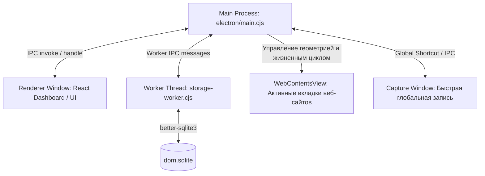
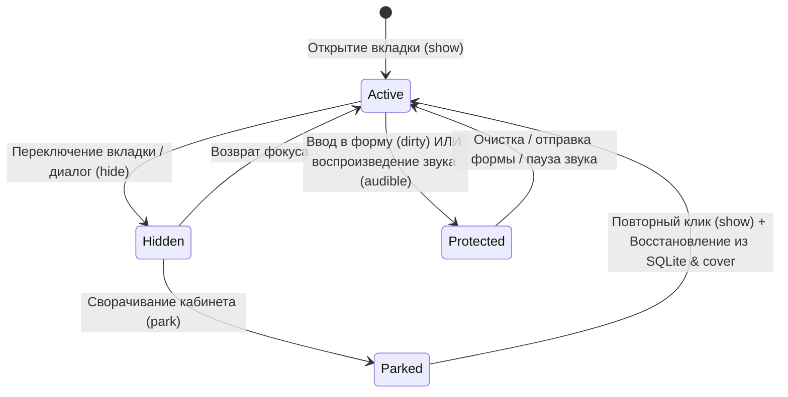

# Архитектура и техническое описание системы dombro

> **Назначение документа:** Полная техническая спецификация устройства проекта, моделей данных, процессов, жизненного цикла памяти, безопасности и интеграций. Служит единым источником правды (Single Source of Truth) для разработчиков и ИИ-ассистентов.

---

## 1. Обзор и стек технологий

**dombro** — это гибрид настольного веб-браузера и спокойного рабочего дашборда для Windows 11 (с архитектурным заделом под macOS), ориентированный на изоляцию рабочих контекстов («Кабинетов»), предотвращение утечек памяти и сохранение фокуса.

### Миссия и концепция Calm Tech (Снятие когнитивной нагрузки):
Продукт спроектирован специально для людей с высоким потреблением информации, испытывающих цифровую тревогу от десятков открытых вкладок и потерю концентрации:
* **Снятие тревожности:** в системе нет красных счетчиков («badges») непрочитанного, штрафов за перенос дел или бесконечных лент (Infinite Scroll). Дайджесты конечны, а остров внимания показывает не более одного сигнала за раз. Плашки отмены действий временные (автоматическое плавное скрытие через 6 секунд с паузой при наведении курсора и кнопкой немедленного закрытия), не перекрывают элементы управления и не создают постоянного визуального шума.
* **Чистый дизайн без мелких шрифтов:** дизайнерская шрифтовая пара Literata (антиква) + Manrope (гротеск), достаточный «воздух», отсутствие нечитаемых мелких кеглей (мельче 12px) и перегруженных таблиц.
* **Самоочевидный UI (Минимум текста инструкций):** интерфейс говорит физикой и расположением, не требуя обучающих простыней, туториалов и всплывающих подсказок.
* **Мягкая кинематика:** пружинные анимации без резких скачков и отскоков (FluidGroup с комфортным перетеканием `duration: .22`, затуханием на месте без рывков к выбранному табу при уходе курсора; устранение масштабирования `scale` окна и кнопок для предотвращения субпиксельного размытия текста; плавное проявление острова внимания через чистый `opacity` без агрессивного `blur` и скачков геометрии; CalmTooltip со стабильным якорением к элементу без дрожания за курсором и умеренной задержкой `200ms` / `100ms`), с полной поддержкой `prefers-reduced-motion`.
* **ДНК микроанимаций** ([`docs/motion.md`](docs/motion.md)): одна кривая `--ease-calm` (`0.32, 0.72, 0, 1`), шесть длительностей (`--motion-press/hover/state/enter/exit/layout`: 120–480 мс), одно появление `calm-in` (8px), вход экранов хаба по очереди (`useScreenEntrance`), нажатие — прозрачность `--press-opacity`, наведение ничего не двигает; токены в `src/motion.css`, зеркало для Motion — `src/motion.ts`, `MotionConfig` задаёт спокойный переход по умолчанию; соблюдение проверяет `tests/motion-dna.test.ts`.
* **Таблица стилей** ([`docs/design-tokens.md`](docs/design-tokens.md)): `src/tokens.css` — единственный источник ролей цвета, состояний, поверхностей (`--surface-glass/card/control/field/popover/sheet/inverse`), линий (`--line-soft/strong/glass`, `--focus-ring`), шкалы скруглений 4–28px с ролями (`--radius-control`, `--radius-popover`, `--radius-card`…), теней и размеров; `src/controls.css` — каноничные кнопки (основная, тихая, вторичная, текстовая, иконка, опасная), плашки, поля и меню со всеми состояниями; `MenuItems` рисует группы, разделители, опасные и отключённые пункты. Проверяет `tests/design-tokens.test.tsx`.
* **Меню и прокрутка:** «клик снаружи» у `ActionMenu`/`ContextMenu` слушается в фазе захвата (триггеры гасят `pointerdown`, чтобы не начиналось перетаскивание), поэтому одновременно открыто не больше одного меню. Страница пространства прокручивается в коротком окне (минимум 900×650), карточка содержимого не сжимается меньше своих строк; сетка «Пространств» — `grid-auto-rows: max-content`.
* **Новая вкладка и напоминания:** поле новой вкладки — настоящий ввод с подсказками адресной строки под ним (`useAddressSuggestions` + общий `OmniboxSuggestionList`; данные — `buildOmniboxSuggestions`), фокус пустой вкладки — в поле страницы. Остров показывает самое свежее наступившее напоминание и один раз «звенит» на свежем сроке (`shouldRing`: колокольчик `island-bell` при `liveHints !== false`, ореол, тихий щипок `sound.playReminderChime` — Karplus–Strong, общая шина −5 дБ); откладывание — `dayModel.snoozeReminder` (день плана следует за временем), перенос на прошедшее время тихий (`quietIfPast`); Electron показывает системное уведомление, только если окно не в фокусе.

### Основной стек:
* **Среда исполнения:** Electron 41 (Node.js 22 runtime + движок Chromium).
* **Пользовательский интерфейс (UI):** React 19, TypeScript, Lucide React (иконки), Literata + Manrope (шрифтовая пара Calm Tech).
* **Сборка и бандлинг:** Vite 6, `tsc` (строгая проверка типов), `electron-builder` (NSIS и Portable сборки под Windows).
* **Хранилище данных:** `better-sqlite3` с FTS5-полнотекстовым поиском, шифрование через `safeStorage` (Windows DPAPI / macOS Keychain).
* **Анимации и физика:** Motion (`motion/react`) с соблюдением стандарта доступности `prefers-reduced-motion`.
* **Тестирование:** Vitest 4 (56 тест-файлов, 391 тест), JSDOM, кастомные нативные тест-раннеры Electron (`tests/cabinet-native.cjs`, `scripts/test-storage.cjs`).

---

## 2. Архитектура процессов Electron

Приложение использует строгую многопроцессную архитектуру с полной изоляцией контекстов и отсутствием `nodeIntegration` в окнах рендеринга.



### 1. Главный процесс (`electron/main.cjs`)
* Управляет окнами (`mainWindow`, `captureWindow`, `splashWindow`), системным треем и глобальными горячими клавишами (`Ctrl+Shift+Space` на Windows, `Cmd+Shift+Space` на macOS). Главное окно использует `titleBarStyle: 'hidden'` с полностью прозрачным нативным оверлеем (`titleBarOverlay: { color: '#00000000', symbolColor: '#2e453b', height: 36 }`), благодаря чему системные кнопки управления (`—`, `❐`, `✕`) бесшовно парят прямо поверх обоев или стеклянной шапки без отвлекающего непрозрачного прямоугольника, с сохранением нативного Snap Layouts Windows 11. Настройки оверлея динамически обновляются через валидируемый IPC-канал `window:setTitleBarOverlay`. При запуске открывает лёгкое окно заставки `splashWindow` (`electron/splash.html`), динамически передавая версию (`?v=${app.getVersion()}`) с отображением `v0.0.1`. Заставка прозрачная и без системной тени: на Windows `setOpacity` у такого окна не работает, поэтому карточка стартует с `opacity: 0` и получает класс `is-in` только после `showInactive` (проявление ~600 мс, без масштаба). Главное окно создаётся скрытым с `opacity: 0`. Показ ждёт минимальное время заставки и появление `.app-shell`, затем окно показывается невидимым, разворачивается, и только после этого проявляется ~640 мс, пока карточка заставки растворяется. При `prefers-reduced-motion` оба окна показываются сразу, без fade. Входная CSS-анимация `.app-shell` не используется: она успевала закончиться, пока окно было скрыто. При повторном нажатии шортката в активном окне записи переключает голосовой ввод (`capture:toggle-voice`).
* Инициализирует вспомогательные менеджеры: `BrowserManager` (браузерные вкладки), `Storage` (БД), `Vault` (пароли), `Gmail` (почта), `AI` (модели).
* Валидирует все IPC-запросы через хелпер `trustedHandle` (проверка источника отправителя на соответствие доверенному UI).

### 2. Процесс рендеринга (`src/`)
* Одностраничное приложение на React 19.
* Доступ к системным функциям получает исключительно через строго типизированный фасад `window.dom` ([`src/bridge.ts`](file:///d:/dev/tools/browser/src/bridge.ts)), предоставленный мостом контекста ([`electron/preload.cjs`](file:///d:/dev/tools/browser/electron/preload.cjs)).
* Полная изоляция: `contextIsolation: true`, `sandbox: true`, `nodeIntegration: false`.

### 3. Рабочий поток базы данных (`electron/storage-worker.cjs`)
* SQLite-операции вынесены в отдельный воркер, чтобы тяжелые транзакции и FTS5-поиск не блокировали UI-поток и IPC.
* Обеспечивает транзакционные мутации состояния через JSON-патчи.
* Воркер — единственный писатель: состояние держится в памяти, `applyChanges` копирует только изменённый путь, в SQLite пишутся только затронутые сущности (`[коллекция, '@id']`), индекс FTS5 перестраивается пачкой через 400 мс. Обёртка [`electron/storage.cjs`](electron/storage.cjs) кэширует последнее состояние для главного процесса; `state:apply` не дублирует состояние окну-отправителю. Подробно — [`docs/performance.md`](docs/performance.md).

### 4. Вкладки сайтов (`WebContentsView` через `electron/browser.cjs`)
* Сайты отображаются **не** через уязвимые `<webview>` теги и **не** через iframe, а через нативные `WebContentsView`, прикрепленные к главному окну.
* Каждая веб-страница изолирована в отдельной сессии Chromium (`persist:dom-browser`), очищается от Electron-сигнатур в User-Agent и защищается прелоадом [`electron/page-preload.cjs`](file:///d:/dev/tools/browser/electron/page-preload.cjs).
* Пароли сохраняются безопасно без кейлоггинга: считывание происходит только при отправке формы (`submit`), а origin верифицируется главным процессом. Данные шифруются системным `safeStorage` в `Vault`. В UI встроен баббл сохранения и автозаполнение по клику.
* Официальное расширение Bitwarden 2026.10.0 проверено через `session.loadExtension`: каталог принимается, service worker завершается, потому что в Electron нет `chrome.webNavigation` (код регистрации 15). Заглушка `onCommitted` упирается в `chrome.notifications` и `getAllFrames`. На форме входа интерфейса Bitwarden нет. Идентификатор загруженного каталога — хеш пути, не id магазина Chrome, поэтому native messaging с настольным Bitwarden не соединяется. При старте архив не скачивается. Статус для настроек отдаёт [`electron/bitwarden-extension.cjs`](file:///d:/dev/tools/browser/electron/bitwarden-extension.cjs). Резервный экспорт/импорт в CSV Bitwarden доступен в настройках.

---

## 3. Модель памяти и жизненный цикл вкладок (Hibernation & Parking)

В отличие от стандартных браузеров, где десятки вкладок остаются в памяти до исчерпания системной RAM, в dombro реализована **детерминированная модель выгрузки неактивных пространств**.



### Защита от потери данных (`record.protected`)
Вкладка считается **защищённой** и гарантированно не выгружается из памяти в следующих случаях:
1. **Несохранённый ввод (`dirty: true`):** Прелоад [`electron/page-preload.cjs`](file:///d:/dev/tools/browser/electron/page-preload.cjs) перехватывает события `input` (текстовые поля, `textarea`, `contenteditable`) и `change` (выпадающие списки `select`, радио-кнопки, чекбоксы).
2. **Воспроизведение аудио/видео (`playing: true` или `audible: true`):**
   * Нативный уровень: `webContents.isCurrentlyAudible()` и события `media-started-playing`, `media-paused`, `audio-state-changed`.
   * DOM-уровень: опрос активных `<video>` и `<audio>` элементов.
   * Звонки Google Meet / WebRTC и фоновая музыка продолжают играть без прерывания.

### Механизм парковки (`BrowserManager.park`)
* При переключении или выходе из пространства ([`src/App.tsx:parkSpace`](file:///d:/dev/tools/browser/src/App.tsx)) вызывается `bridge.browser.park(tabIds)`.
* **Честный замер освобождённой памяти:** перед уничтожением нативных `WebContentsView` менеджер собирает `getOSProcessId()` выгружаемых вкладок, сопоставляет их с `app.getAppMetrics()` главного процесса, суммирует `memory.workingSetSize` (в КБ) и возвращает точное число `freedMB`.
* Для каждой незащищённой вкладки:
  1. Делается мгновенный скриншот (`capturePage()`), сжимается до 1000px и отправляется в кэш обложек `tabCovers`.
  2. Метаданные (URL, title, favicon, scrollY) сохраняются в SQLite.
  3. Нативный `WebContentsView` безопасно уничтожается, полностью освобождая память процесса Chromium.
* Защищённые вкладки остаются активными в фоновом режиме; пользователю выводится уведомление о количестве удержанных в памяти вкладок.

### Автовыгрузка неактивных вкладок (Memory Saver, [`electron/tab-memory.cjs`](electron/tab-memory.cjs))
* Раз в минуту `BrowserManager.discardIdle()` закрывает скрытые незащищённые вкладки, скрытые 30 минут и дольше, и старейшие скрытые сверх 12 живых.
* Видимые и защищённые (ввод, воспроизведение, звук) не трогаются; `close(id, false)` оставляет страницы, которые просят остаться.
* Вкладка остаётся в сессии: при возврате `show()` создаёт страницу заново по URL с позицией прокрутки, до загрузки виден снимок из `tabCovers`.

### Режим браузера: новая вкладка и полоса вкладок (единая система)
* **Новая вкладка ([`src/browser/NewPage.tsx`](src/browser/NewPage.tsx))** построена по схеме «Порог», как страница пространства: надзаголовок (`{пространство} · следующий шаг`) → следующий шаг крупным Literata 32/40 (если шага нет — «Новая вкладка» / «С чего начнём?») → одно поле адреса (56px, белое, `Ctrl L`) → «Материалы N» строками по 64px в две колонки. Отдельная плашка «Следующий шаг», стрелки в каждой карточке и сноска-пояснение убраны.
* Материалы используют общие метки: `FileTypeBadge` для файлов (Ps/Ai/X…), фавикон или монограмму домена для ссылок, подпись формата `documentFormat()` — она перенесена из `CabinetContents` в [`src/resourcePresentation.ts`](src/resourcePresentation.ts) и одинакова на обеих страницах.
* Все стили новой вкладки — один блок «Browser · new tab» в [`src/card-system.css`](src/card-system.css) на токенах `--ink-*`, `--hairline`, `--accent-soft`, `--t-*`; прежние правила из `browser-shell.css` и `browsing.css` (кегли 12–13px) удалены. Минимальный кегль — 14px.
* **Полоса вкладок:** высота полосы 36px (вместо 46px), высота табов 34px (вместо 38px), расстояние от верхнего края табов до верхней панели инструментов уменьшено до 2px (вместо 8px), оставляя максимум полезной площади веб-странице. Шрифт названий вкладок — компактный `--fs-tab` (13px, Manrope). Кнопка закрытия (24×24px, иконка 15px) постоянно видна только у активной вкладки; у остальных появляется при наведении или фокусе (`browsing.css`), поэтому заголовкам остаётся больше места. Без фавикона `TabIcon` показывает ту же монограмму домена (`SiteMark`, 18px), что и страница пространства, вместо одинакового глобуса.
* **Закреплённые вкладки** (`.horizontal-tab.is-pinned`) — только иконка, фиксированные 44px, без крестика; ширину обычных вкладок (до 192px) `Workstage` считает из места, оставшегося после закреплённых.
* **Островок внимания в шапке** (`AttentionIsland` с `browser`): в свёрнутом виде — прозрачная кнопка с тем же значком сигнала, что у «Уведомлений» на дашборде (колокольчик, если сигнала нет). При сигнале — маленькая зелёная метка (не красная, без числа), в широком виде — мягкая плашка с текстом 14px рядом со значком.
* **«Стол» (`TabOverview`)**: у вкладки без снимка вместо пустоты — поле с монограммой домена той же высоты, что снимок, поэтому сетка ровная; кнопки «…» и «×» на карточках видны при наведении, фокусе или выделении (на сенсорных экранах — всегда); подписи 14px.
* **Шапка:** прямой вход «Новое пространство» сохранён (продуктовое правило «одна задача — одно пространство»), но оформлен прозрачной кнопкой-иконкой, как соседние, без белой подложки; подпись «Материалы» — 14px.

### Кэш обложек вкладок (`tabCovers`) и превью при наведении
* **Когда снимается:** `BrowserManager.hide()` (вкладка ушла с экрана) и `block()` (поверх нативной страницы открыт диалог/меню). Снимок ужимается до ширины ≤1000px и кодируется в JPEG (качество 82) функцией `coverImage()` в [`electron/browser.cjs`](electron/browser.cjs); JPEG в 3–5 раз легче прежнего PNG при том же разрешении, которого достаточно для zero-flicker подложки `.native-cover`.
* **Где хранится:** только в памяти рендерера — состояние `tabCovers` в `App.tsx`, не больше 40 последних снимков. В SQLite и на диск не пишется; после перезапуска снимков нет, пока вкладку не откроют снова. Формат проверяет общий `isTabCover()` ([`src/tabCover.ts`](src/tabCover.ts): `data:image/png|jpeg;base64`).
* **Превью при наведении ([`src/TabPeek.tsx`](src/TabPeek.tsx), хук `useTabPeek`):** в карточке материалов пространства (`CabinetContents`) строка вкладки показывает готовый снимок через 450 мс наведения или при фокусе с клавиатуры (`:focus-visible`); при переходе между строками — через 90 мс. На весь список одна всплывающая карточка 320×244 (портал в `body`, `position: fixed`, справа от строки, при нехватке места — слева или снизу). Скрывается при уходе курсора, клике, нажатии (`pointerdown`), начале перетаскивания, прокрутке, изменении размера окна и Escape. Для вкладок без снимка ничего не показывается.
* **Стоимость:** наведение не загружает страницу и не вызывает `capturePage()` — рисуется один `` из уже лежащего в памяти data URL (`decoding="async"`). Дополнительная память не расходуется.
* Строки вкладок помечены `data-tooltip-off`: общий `CalmTooltip` не дублирует видимое название.
* В браузерном превью (без Electron) `previewTabCovers()` из `previewFixture.ts` рисует на canvas условные макеты страниц для тестовых вкладок — это не скриншоты; три вкладки намеренно оставлены без снимка.
* Тестовые данные превью (`previewFixture.ts`): разовое пространство с вкладками и файлами плюс ежедневно пересоздаваемый набор `demo-…` (дела, события, пространства, закладки, новости, почта, история) — состав и правила в README → «Запуск в Chrome».

### Физика анимаций и Calm Motion (Тактильные анимации порядка)
1. **«Оригами-парковка» (`tabCovers` → `ResumeCard`):**
   * В момент вызова `parkSpace` сохранённые обложки страниц из `tabCovers` плавно складываются веером в стопку `ParkedCoversStack` на карточке «Продолжить работу» ([`src/ResumeCard.tsx`](file:///d:/dev/tools/browser/src/ResumeCard.tsx)).
   * Полноэкранный контейнер [`src/browser/NativePane.tsx`](file:///d:/dev/tools/browser/src/browser/NativePane.tsx) и миниатюры в стопке связаны через общий `layoutId={tab-cover-${spaceId}-${tabId}}` из `motion/react`.
   * Карточка «Продолжить» мягко принимает стопку (`fluidSpring.slow`, без отскока), сохраняя шрифт Manrope без `scale` для исключения субпиксельного размытия.
2. **«Выдох оперативки» (`AttentionIsland` + фоновая световая волна):**
   * При освобождении памяти Chromium по фоновому пейзажу дашборда запускается однократная мягкая радиальная световая волна (`.dashboard-relief-wave`, `opacity: 0 -> 0.35 -> 0` за 2 × `--motion-layout`).
   * Верхний Остров внимания ([`src/AttentionIsland.tsx`](file:///d:/dev/tools/browser/src/AttentionIsland.tsx)) плавно проявляет капсулу `MemoryReliefSignal` с крутящимся барабаном цифр (`useSpring` + `useTransform`): «Кабинет на паузе · Освобождено X МБ / X.X ГБ ОЗУ».
3. **«Выдувание шума из головы» (Аппаратный SVG-фильтр растворения):**
   * В корень экрана встроен аппаратный фильтр `CalmWindSvgFilter` ([`src/CalmWindSvgFilter.tsx`](file:///d:/dev/tools/browser/src/CalmWindSvgFilter.tsx), `#calm-wind-dissolve`) на базе `<feTurbulence>` и `<feDisplacementMap>`.
   * При очистке черновика в [`src/ScratchpadWidget.tsx`](file:///d:/dev/tools/browser/src/ScratchpadWidget.tsx) удаляемый текст мягко рассеивается по ветру вправо-вверх (`x: 12, y: -4, filter: url(#calm-wind-dissolve) blur(4px)`) за `--motion-layout`.
   * При включённом `prefers-reduced-motion` фильтр автоматически отключается и заменяется на прямое затухание `opacity: 0` (`fluidExit`).
4. **Процедурный тактильный саунд-дизайн Calm Tech ([`src/sound.ts`](file:///d:/dev/tools/browser/src/sound.ts), спецификация [`docs/calm-sound-engine.md`](file:///d:/dev/tools/browser/docs/calm-sound-engine.md)):**
   * Исключение раздражающих цифровых писков и звонков (частоты выше 2500 Гц не используются).
   * Полный синтез на базе Chromium Web Audio API без внешних аудиофайлов.
   * Низкочастотный срез (Low-Pass на уровне 900–1800 Гц) и микро-джиттер высоты тона (±3%), чтобы звуки звучали матово, приглушённо и тактильно.
   * Поддержаны 4 базовых акустических паттерна: глухой деревянный щелчок `playWoodSnap` (смена магнитного силуэта и посадка карточки в сетку), шелест бумаги `playPaperFold` (складывание вкладок в карточку «Продолжить»), двухфазный тумблер `playCaptureToggle` (голосовой ввод Capture по Ctrl+Shift+Space) и мягкий выдох `playCalmExhale` (очистка заметок и появление капсулы освобождённой памяти в Острове внимания).
   * Мгновенное переключение в один клик в настройках с сохранением состояния в `localStorage`.

### Бесшовное пробуждение (Zero-Flicker Restoration)
* При повторном открытии выгруженной вкладки компонент [`src/browser/NativePane.tsx`](file:///d:/dev/tools/browser/src/browser/NativePane.tsx) мгновенно рендерит сохраненный снимок страницы (`.native-cover`), переданный через карту обложек `tabCovers`.
* Новый `WebContentsView` создается и загружает URL в фоне, не показывая пользователю белый экран или мигание пустого окна.

### Система фонового оформления (Живые видеообои и статические фоны)
* **Двухуровневая архитектура фона (`src/App.tsx`, `src/WallpaperPicker.tsx`, `src/styles.css`, `src/Settings.tsx`):**
  * Поддерживаются как живые видеообои (`.mp4`, `.webm`, `.ogg`, функция `isVideoWallpaper`), так и расширенная коллекция спокойных 3D-фонов без мелких деталей и шума:
    * **Живой видеофон:** «Живые волны (видео)» (`/bg.mp4`, оригинальный файл сохранён в корне).
    * **Облака и небо:** «Облака и небо» (`/backgrounds/abstract-sky.jpg`) — мягкие пастельные волны облаков, лазурный простор и тёплый рассветный свет.
    * **Кораллы и морское дно:** «Кораллы и дно» (`/backgrounds/abstract-ocean.jpg`) — спокойные океанские дюны, глубокий бирюзовый тон и рассеянный свет.
    * **Холмы и волны:** «Волны: Полдень / Рассвет / Сумерки» (`abstract-hills.jpg`, `abstract-morning.jpg`, `abstract-dusk.jpg`) и «Классический луг» (`meadow-background-v2.png`).
  * **Курируемая коллекция без визуального мусора («выбрать готовое»):** из интерфейса выбора фона убраны отвлекающие формы внешней загрузки и ссылок; пользователю доступна чистая сетка проверенных Calm Tech-пресетов с бейджем «Видео» для живых обоев и мгновенным предпросмотром.
  * **Доступность в настройках:** компонент `WallpaperPicker` интегрирован напрямую в основной раздел настроек ([`src/Settings.tsx`](file:///d:/dev/tools/browser/src/Settings.tsx), раздел «Общие», с поиском по ключевым словам «обои / фон / видео»), а также во вкладку «Обои» в параметрах дашборда ([`src/DashboardSettings.tsx`](file:///d:/dev/tools/browser/src/DashboardSettings.tsx)).
  * При активации видео фона в корень `.app-shell` монтируется изолированный контейнер `.app-shell-video-container` (`pointer-events: none; z-index: 0`) с нативным элементом `<video autoPlay loop muted playsInline poster={...}>`.
  * Элементы интерфейса дашборда и стеклянные поверхности (`.page-wrap`, `z-index: 1`) плавно накладываются поверх видео; эффекты матового стекла (`backdrop-filter: blur(...)`) в доке и карточках мягко рассеивают движение пейзажа без отвлечения внимания.
  * **Фон по умолчанию и резервное изображение:** по умолчанию используется классический статичный фон «Волны: Полдень» (`DEFAULT_WALLPAPER = '/backgrounds/abstract-hills.jpg'`), а пользователь может в любой момент переключиться на живой видеофон или другую тему. В качестве постера и CSS-переменной `--app-bg` используется изображение `FALLBACK_IMAGE_WALLPAPER` (`/backgrounds/abstract-hills.jpg`), благодаря чему при загрузке или буферизации видео исключено мигание.
  * **Прокрутка модальных окон настроек (`src/settings.css`, `src/Settings.tsx`):** панель содержимого `.settings-panel` оснащена вертикальной прокруткой (`overflow-y: auto`, `overscroll-behavior: contain`) с кастомным спокойным скроллбаром (`rgba(48, 79, 60, 0.28)` и `var(--radius-sm)`). Заголовок секции пробрасывает события колеса мыши в активную панель, а боковое меню `.settings-sidebar` защищено от переполнения на компактных экранах.
  * Calm Tech & `prefers-reduced-motion`: при включении режима уменьшения движения медиавыражение `@media (prefers-reduced-motion: reduce)` автоматически скрывает видеоконтейнер, сохраняя спокойное статическое фоновое изображение.
  * Видеофон воспроизводится строго без звука (`muted`), исключая звуковую нагрузку.

---

## 4. Хранилище данных и безопасность

### 1. Локальная база данных (`dom.sqlite`)
* Расположение: `%APPDATA%\dombro\dom.sqlite` (или `%APPDATA%\dombro-cabinet-pilot` в режиме пилота).
* Содержит единое состояние приложения `app` в сериализованном виде, а также таблицы полнотекстового индекса FTS5.
* Автоматическое создание снимка на старте (`dom.previous.sqlite`) и возможность ручной резервной копии (`dom.manual.sqlite`).

### 2. Защита секретов (`secrets.encrypted.json`)
* Ключи API (OpenAI, Anthropic), OAuth-токены Gmail и секретные адреса календарей iCal шифруются на уровне операционной системы через `safeStorage` (Windows Data Protection API / macOS Keychain).
* При недоступности системного шифрования сохранение секрета отклоняется.

### 2.1. Граница доверия интерфейса (подробно — [`docs/security.md`](docs/security.md))
* **Пароли** не покидают главный процесс: интерфейс получает сводки без паролей (точное совпадение хоста), автозаполнение идёт по `credentialId`, перехваченный на странице пароль хранится под токеном до ответа на «Сохранить пароль?», экспорт CSV пишет главный процесс.
* **Запуск и чтение локальных файлов** (`resource:open`, `material:read`) — только для путей из [`electron/approved-paths.cjs`](electron/approved-paths.cjs): окно выбора файла, недавние файлы, список окон, Ctrl+Shift+S; ресурсы, сохранённые до этой версии, приняты один раз.
* **Сеть:** ленты, календари и чтение ссылок — через `fetchPublic` (без `localhost` и частных сетей, перенаправления проверяются на каждом шаге). Подсказки Google выключены по умолчанию (`state.searchSuggestions`) и не получают адресов, путей, почты и токенов.
* **Вкладки:** разрешения сайтов по источнику, с сохранением в `site-permissions.json`; вопрос перед загрузкой исполняемых файлов; общий `web-contents-created` запрещает `<webview>` и новые окна по умолчанию; IPC окон Windows принимает только дескрипторы `0x…`.

### 3. Безопасность браузинга и совместимость с сервисами авторизации
* **Защита от блокировок Google Auth и Cloudflare Turnstile (Антидетект Chromium):**
  * В `electron/main.cjs` отключен флаг автоматизации Blink: `app.commandLine.appendSwitch('disable-blink-features', 'AutomationControlled')`. Это исключает детект `WebContentsView` как автоматизированного тестового драйвера.
  * В `electron/browser.cjs` для сессии браузера через `session.webRequest.onBeforeSendHeaders` перехватываются сетевые заголовки: `Sec-CH-UA` и `Sec-CH-UA-Full-Version-List` динамически заменяются на бренд `"Google Chrome"` с синхронизацией мажорной и полной версии Chromium (`process.versions.chrome`), а сигнатуры `Electron/...` вырезаются из `User-Agent`.
  * В `electron/page-preload.cjs` свойство `navigator.webdriver` переопределено на возврат `false` (через `Object.defineProperty`) как в изолированном контексте прелоада, так и внедрением скрипта в основной мир DOM страницы.
  * Резервный вход (OAuth Fallback): для сервисов с параноидальными блокировками в `BrowserPane.tsx` доступна кнопка «В браузере» (`onOpenExternal`), открывающая поток авторизации в системном браузере ОС.
* **Поддержка Widevine DRM (Медиапотоки Spotify, Netflix, Кинопоиск):**
  * В `electron/main.cjs` внедрено ожидание инициализации DRM-модулей `components.whenReady()` перед созданием окон, обеспечивающее совместимость со специализированной сборкой `@castlabs/electron-releases` и VMP-подписью Castlabs EVS.
* **Подпись релизов и обход экрана Windows SmartScreen:**
  * Документированы экономичные стратегии устранения синего экрана защиты: облачная подпись Azure Trusted Signing (~$9.99/мес.), публикация в Microsoft Store ($19 разово) и бесплатный сертификат SignPath.io для Open Source (детали в [`docs/prod-security-guide.md`](file:///d:/dev/tools/browser/docs/prod-security-guide.md)).
* **Запрет всплывающих окон:** `setWindowOpenHandler` отклоняет произвольное создание окон (`action: 'deny'`) и направляет ссылки в табы dombro.
* **Защита от перекрытий:** `MutationObserver` в UI отслеживает модальные окна, меню и слои drag-and-drop, вызывая `browser.block(true)` для блокировки кликов по нативным слоям.
* **Контроль прав:** системный обработчик `setPermissionRequestHandler` для камеры, микрофона, уведомлений и буфера обмена запрашивает явное подтверждение через UI ([`PermissionPrompt.tsx`](file:///d:/dev/tools/browser/src/browser/PermissionPrompt.tsx)).

---

## 5. Продуктовые концепции и пользовательские сценарии

```
┌─────────────────────────────────────────────────────────────┐
│                          ДАШБОРД                            │
│  ┌────────────────┐ ┌──────────────────┐ ┌───────────────┐  │
│  │ Мой день / План│ │Карточка «Продол- │ │   RSS-Выпуск  │  │
│  │ и Календарь    │ │жить» (контекст)  │ │   (без шума)  │  │
│  └────────────────┘ └──────────────────┘ └───────────────┘  │
│  ┌───────────────────────────────────────────────────────┐  │
│  │      КАБИНЕТЫ (Пространства без лишней иерархии)      │  │
│  │  [Логотип] [Презентация] [Исследование] [Личное]      │  │
│  └───────────────────────────────────────────────────────┘  │
└─────────────────────────────────────────────────────────────┘
                               ▲
           Явный вход в работу │ Возврат на главную
                               ▼
┌─────────────────────────────────────────────────────────────┐
│                      РЕЖИМ БРАУЗИНГА                        │
│  [Шапка: Остров внимания] [Переключатель Кабинета] [Стол]   │
│  [Вкладка 1] [Вкладка 2 (звук)] [Вкладка 3] [+]             │
│  ─────────────────────────────────────────────────────────  │
│  [Живой WebContentsView 1]  | [Панель материалов кабинета:  │
│  (или просмотр рядом)       |  локальные файлы .fig / .psd] │
└─────────────────────────────────────────────────────────────┘
```

### 1. Кабинеты (Spaces)
* Единица организации работы. Кабинет объединяет открытые вкладки, прикрепленные документы (файлы Windows) и следующий шаг.
* Не требует обязательного ведения канбан-досок или статусов: закрыл приложение — открыл, всё на месте.

### 2. Карточка «Продолжить» ([`ResumeCard.tsx`](file:///d:/dev/tools/browser/src/ResumeCard.tsx)) и модульная сетка Дашборда
* На главной странице гарантированно существует и располагается в левом верхнем углу (строка 1, над новостями) при наличии хотя бы одного таба с пространством через функцию `activeOrRecentContinuation`. Даже если у пространства нет открытых вкладок, документов или явного чекпоинта, карточка показывает статус готовности к работе («Пространство готово к работе») и открывает кабинет по клику.
* **Принцип персистентности (No Auto-Dismiss):** даже если все пространства удалены, карточка «Продолжить» остаётся на дашборде в пустом состоянии («Нет открытых пространств» с быстрой кнопкой «Создать пространство») и не исчезает самопроизвольно. Карточка существует до тех пор, пока пользователь явно сам не удалит её через режим редактирования сетки (кнопка `✕` в `.dashboard-edit-toggle` / `removeWidget`). При появлении таба пространства карточка гарантированно восстанавливается на главном месте слева сверху над новостями.
* Запускает связанные локальные файлы в системных программах по умолчанию (через `shell.openPath`), восстанавливает живые вкладки и показывает следующий шаг.

### 2.1. Интерактивная модульная сетка и режим редактирования дашборда
* **Сетка дашборда (`.dashboard-grid`):** Единый 12-колоночный модульный грид с половинным шагом строк (`grid-template-columns: repeat(12, minmax(0, 1fr))`, `grid-auto-rows: 56px`, `gap: 18px`, `grid-auto-flow: row`), применяемый во всех режимах (`.custom-grid` в обычном просмотре и `.editing-grid` при редактировании). Для исключения хаотичных перестановок карточек при ресайзе внедрен детерминированный алгоритм вычисления колонок (`computeWidgetPositions` в `src/dashboard.ts`): карточки пакуются в виртуальные строки шириной до 12 колонок с явной привязкой `--widget-col-start` (`grid-column: var(--widget-col-start, auto) / span ...`). Это гарантирует предсказуемость колоночной структуры (первая карточка строки всегда жестко стартует с колонки 1, вторая — с колонки 7 и т.д.): уменьшение высоты правой карточки больше не приводит к перескоку левой нижней карточки в освободившуюся дыру справа. Устранено расхождение с устаревшим двухрядным `standard-grid` (где 2-я строка была зафиксирована на 304px, приводя к вертикальному переполнению до 608px+ и появлению скроллбара). Высота стандартного двухрядного набора карточек составляет ровно 574px (`4 × 56 + 3 × 18 = 278px` для карточек на 4 ряда, `6 × 56 + 5 × 18 = 426px` для карточки дня на 6 рядов), что гарантирует идеальное вертикальное вмещение без прыжков верстки при входе и выходе из режима редактирования. Дискретность ресайза удвоена по обоим измерениям: горизонтальный шаг составляет ~101.5px (вместо 203px), а базовый вертикальный ряд равен 56px (2 ряда с учетом зазора дают ровно 130px: `2 × 56 + 18 = 130px`). Раскладки автоматически мигрируют (`gridVersion: 2`), масштабируя старые сохранённые `colSpan` и `rowSpan` в 2 раза без потери пропорций.
* **Единый ритм и субпиксельное выравнивание карточек (`src/card-system.css`, `src/dashboard.css`):**
  * Верхний внутренний отступ зафиксирован строго на токен `--card-pad: 24px` для всех карточек дашборда (`.calm-card`). Устранены артефакты оверрайдов (16px в компактных состояниях).
  * Карточка «Пространство» (`ResumeCard`): стандартный размер 6×4 классифицируется как полноразмерная карточка (флаг `isSmall` зарезервирован только под карточки `rowSpan <= 3` или `colSpan <= 4`). Из анимации карточки удален паразитный сдвиг `initial={{ y: 2 }}`, исключающий появление трансформации `translateY(2px)`.
  * Шапки карточек (`.calm-card-heading`, `.resume-card-heading`, `.reading-shelf-header`): имеют единую высоту 28px, а внутренние элементы (`.card-icon-tile`, `.resume-space-link`, `.reading-shelf-title`) центрированы с `padding: 0 !important`. В результате верхний край всех иконок и базовая линия текста во всех карточках первого и второго рядов выстраиваются на одинаковое расстояние ровно 28px от верхнего края карточки.
* **Тактильный ресайз карточек (Super-smooth Edge & Corner Resizing, [`src/useDashboardDrag.ts`](file:///d:/dev/tools/browser/src/useDashboardDrag.ts)):**
  * Захват за все края и угол: левый край (`.widget-edge-left`, курсор `ew-resize`), правый край (`.widget-edge-right`, курсор `ew-resize`), нижний край (`.widget-edge-bottom`, курсор `ns-resize`) и правый нижний угол (`.widget-corner-handle`, курсор `nwse-resize`). Тонкие успокаивающие hover-индикаторы (`rgba(72, 115, 70, 0.75)`). При ресайзе за левый край карточка динамически компенсирует смещение (`translateX(resizeShiftX)`), сохраняя правую границу на месте и адаптируя соседа слева.
  * 1-to-1 непрерывное пиксельное следование: во время движения мыши карточка меняет размеры непрерывно в пикселях (`transition: none !important`), исключая рывки и прыжки верстки.
  * **Направленная изоляция и резиновый упор (Rubber-band Resistance):** при жесте ресайза за правый край или угол крайней правой карточки (`edge === 'right' || edge === 'corner'`) запрещено сжимать левого соседа или смещать левую границу виджета. Если свободное место в строке исчерпано, ширина карточки мягко упирается с суб-линейным тактильным сопротивлением (`Math.pow(over, 0.55) * 1.5`), а при отпускании плавно возвращается в размер модульной сетки без деформации строки.
  * Магнитный силуэт приземления (Ghost Snap Outline, `.widget-ghost-snap-outline`): полупрозрачный контур с мягким переходом (150 мс) и бейджем размерности (`${colSpan} × ${rowSpan}`), показывающий будущую ячейку модульной сетки (для левого ресайза позиционируется от правого края `.ghost-from-right`).
  * Плавное приземление (Snap Landing): при `pointerup` карточка плавно анимируется (`.is-snapping`, `transition: width 0.22s cubic-bezier(0.2, 0, 0, 1), height 0.22s`) из текущих пикселей в размер целевой ячейки, после чего фиксируются `colSpan` и `rowSpan` в `WidgetConfig`, а инлайн-пиксели очищаются. Полная поддержка `prefers-reduced-motion` (мгновенная фиксация без задержек).
* **Режим редактирования (Canvas Edit Mode) и Drag & Drop:**
  * **Единый плавающий слот управления (`.dashboard-floating-controls`):**
    * Устранена пустая горизонтальная строка между строкой поиска и карточками (`.calm-heading`), что позволило подтянуть дашборд вверх без паразитных зазоров.
    * В обычном режиме справа от карточек (в 14px от правого края сетки: `left: calc(100% + 14px)`) парит лаконичная круглая стеклянная кнопка настроек 38×38px с иконкой `SlidersHorizontal` (`.edit-fab-toggle`).
    * **Единый диаметр 38px (Anti-bloat):** все кнопки управления (`.edit-fab`, `.edit-fab-toggle`, `.edit-fab-cancel`, `.edit-fab-add`, `.edit-fab-done`, `.edit-fab-presets`) приведены к строго одинаковому размеру 38×38px с компактным шагом `gap: 8px`. Исключён разнобой диаметров и рывки размеров при раскрытии панели.
    * **UX пространственной фиксации отмены (In-place Close Cross):** при клике на кнопку настроек в позиции №1 (ровно в той же точке, где находился курсор пользователя) оказывается крестик отмены/закрытия (`.edit-fab-cancel` с `<X size={17} />`). Пользователь может мгновенно закрыть настройки повторным кликом без перемещения курсора. При наведении применён спокойный шалфейный тон (`#1c3624` на белом фоне) без тревожных красных цветов.
    * **Каскадное раскрытие и отделение пресетов:** кнопка добавления виджета (`+`) и сохранения (`Check`) плавно спускаются каскадом вниз (`@keyframes fab-cascade-in`), а кнопка пресетов (`BookmarkPlus`) опускается на самый низ панели и визуально отделяется деликатным горизонтальным разделителем (`.dashboard-floating-divider`, 20×1px). При выходе панель плавно сворачивается обратно в одиночную кнопку `SlidersHorizontal`.
    * Кнопки расположены вплотную к сетке карточек (ровно 14px зазора на экранах любой ширины), а на экранах `< 1340px` мягко прижимаются к правому краю окна без выхода за пределы экрана. На мобильных экранах (`< 760px`) панель трансформируется в нижний горизонтальный ряд.
  * **Вертикальный скролл и градиентное размытие краёв (Vertical Rail Mask, по аналогии с «Все пространства»):**
    * Высота каркаса `.page-wrap` оптимизирована до `min(890px, calc(100dvh - 54px))`, а вертикальное позиционирование переведено в `align-items: flex-start; justify-content: center;` с верхним отступом `margin: clamp(24px, 4.2vh, 46px) auto 0;`.
    * Весь дашборд подтянут выше на ~100px в верхнюю зону неба без коллизий с кнопками заголовка окна Windows, а рабочая область `.hub-content` расширена до 614px (при 1080p).
    * Стандартный двухрядный шаг горизонтальной сетки карточек (высота двух 4-рядных карточек с зазором 18px составляет 574px + 20px паддинга = 594px) полностью и гарантированно умещается в экран 1920×1080 без появления вертикального скроллбара и размытия.
    * Сетка обёрнута в контейнер `.dashboard-scroll-wrap` с `height: 100%; max-height: 100%;` и лаконичным тонким скроллбаром 6px в спокойных тонах Calm Tech (`rgba(48, 79, 60, 0.28)`). Скроллбар и градиентная маска плавно активируются только при наличии 3-го ряда карточек или их сильном увеличении пользователем.
    * В режиме редактирования или при активном перетаскивании/ресайзе карточек маска гарантированно отключается (`mask-image: none !important`), что исключает любое клиппирование или размытие перемещаемых карточек.
  * **Защита от обрезки (Zero-clipping):** контейнеры `.hub-content:has(.calm-home)` и `.dashboard-home` переведены в `overflow: visible !important`, а перетаскиваемой карточке задан `z-index: 1000 !important`, что гарантирует полное отсутствие обрезки слева, справа, сверху или снизу при перемещении.
  * **Доступность всех карточек:** устранена обрезка ручек ресайза, дочерние интерактивные элементы в режиме редактирования изолированы (`pointer-events: none`), а ручки и кнопка удаления выведены на передний план (`z-index: 50 !important`). Карточку можно захватить за любую точку её поверхности.
  * **Кнопки удаления (`.widget-remove-btn`):** расположены строго внутри карточки (`top: 10px; right: 10px;`), размер увеличен до комфортного хитбокса 28×28px (иконка 15px) с мягким полупрозрачным фоном и `backdrop-filter: blur(8px)`.
  * **Плавающее превью и кинематика (Floating Drag Preview):** перетаскиваемая карточка перемещается строго горизонтально без наклона (убран `rotate`, используется только лёгкий подъём `scale(1.02)` и глубокая мягкая тень), а на её месте в сетке отображается силуэт-плейсхолдер.
  * **Стабильность координат и защита от улетания:** при смене слотов сетки вычисляется истинное положение слота за вычетом активного смещения (`currentSlotLeft = dragRect.left - dx`), что гарантирует нулевой джиттер и предотвращает улетание карточки за пределы экрана.
  * **Плавное приземление (Landing animation):** при отпускании карточка мягко опускается в слот за 220 мс (`transition: transform 0.22s cubic-bezier(0.2, 0, 0, 1)`).
* **Адаптация соседних карточек в строке ([`src/dashboard.ts:adaptRowSpans`](file:///d:/dev/tools/browser/src/dashboard.ts)):**
  * **Спокойный ресайз без самопроизвольного расширения соседей:** при уменьшении ширины карточки (как правой, так и левой) соседние карточки в строке **не увеличиваются сами** и не заполняют экран, сохраняя свои исходные размеры. Освободившиеся колонки остаются свободным пространством справа в строке.
  * **Защита правого края и удержание пропорций:** при увеличении ширины левой карточки вправо соседняя правая карточка сохраняет свой размер, пока в строке есть свободные колонки; если же правая карточка уже упёрлась в правый край дашборда (или свободное место исчерпано), правая карточка плавно уменьшается до своего допустимого минимума (`minCol`).
  * **Изоляция краёв:** правая карточка при попытке растянуть её за правый край дашборда не может выйти за пределы 12 колонок и не сжимает соседа слева (резиново сопротивляется). Сжатие левого соседа возможно только при явном перетаскивании левой ручки карточки влево (`edge: 'left'`).
* **Карточки Calm Tech и гибкая высота:**
  * **«Продолжить» ([`src/ResumeCard.tsx`](file:///d:/dev/tools/browser/src/ResumeCard.tsx)):** ограничение минимальной высоты снижено до 1 строки (`minRow: 1`). При сжатии до `rowSpan <= 2` (соответствует ≤ 130px) карточка переходит в компактный однострочный режим (`is-compact-row`) с размещением названия пространства, индикаторов вкладок/документов, заголовка и кнопки перехода в одну линию. При малых габаритах (`rowSpan <= 4`, `colSpan <= 5` или размер `S`) активируется класс `.is-small-card` с оптимизированными паддингами (`16px 20px 14px`), уменьшенной кнопкой (36px) и гарантированным сохранением кнопки перехода строго внутри карточки с комфортным зазором.
  * **«Заметки / Черновик» ([`src/ScratchpadWidget.tsx`](file:///d:/dev/tools/browser/src/ScratchpadWidget.tsx)):** постоянный блокнот на главном экране с непрерывным автосохранением в SQLite (`scratchpadNote`), поддержкой списков задач и кнопкой быстрого превращения строки в дело.
  * **«Почитать» (ранее «Чтение на потом», [`src/ReadingShelfWidget.tsx`](file:///d:/dev/tools/browser/src/ReadingShelfWidget.tsx)):** полка отложенных статей и ссылок из пространств с расчетом времени чтения, быстрым переходом и отметкой «прочитано».
    * **Два режима отображения (List & Grid):** переключатель в шапке карточки с сохранением выбора в `localStorage` (`dombro:reading-shelf-view`).
      * *Список (`list`):* строчный лаконичный вид, где каждая строка содержит фавикон ресурса, название статьи (Inter Regular 16px), строку метаданных (`{domain} · {readMins} мин · {space}`) и деликатную кнопку завершения (`.reading-shelf-check`).
      * *Плитки (`grid`):* адаптивная сетка с квадратными карточками (`minmax(104px, 1fr)`). Каждая плитка содержит соотношение сторон 1:1, скругление 14px, реальный скриншот вкладки из `covers` (при наличии) либо процедурную Calm Tech обложку (6-тоновая пастельная палитра шалфея, песка и терракоты, крупная монограмма Literata Medium 28px, стеклянный бейдж фавикона домена с защитой от ошибок загрузки, полупрозрачный индикатор времени чтения `⏱ {mins} мин` и быстрая галочка отметки о прочтении).
    * **Градиентное размытие краёв и скроллбар:** контейнер `.reading-shelf-scroll` использует динамические классы `.has-before` и `.has-after` с `mask-image: linear-gradient(...)` для мягкого растворения переполняющегося контента сверху и снизу, а также кастомный спокойный 5px скроллбар.
    * **Порционная прогрессивная подгрузка (High Performance Infinite Batching):** для исключения просадок FPS и перегрузки DOM при сотнях сохранённых статей данные рендерятся порциями (`PAGE_SIZE = 12`). При достижении 60px до конца скролла автоматически монтируется следующая пачка элементов, что гарантирует мгновенный отклик и плавность интерфейса.
    * При узкой ширине карточки (`colSpan <= 5`, класс `.is-small-card`) оптимизируются отступы и метаданные без горизонтального скролла (`overflow-x: hidden`).
  * **«Подробная погода» ([`src/WeatherWidget.tsx`](file:///d:/dev/tools/browser/src/WeatherWidget.tsx)):** подробная метеокарточка на базе открытого API Open-Meteo без внешних API-ключей. Отображает текущую температуру, состояние неба, «ощущается как», влажность, скорость ветра (м/с) и осадки. Включает прогноз на 5–7 дней и селектор городов (Уфа, Москва, Санкт-Петербург, Казань, Екатеринбург, Новосибирск, Сочи) с кэшированием в localStorage и кнопкой быстрого перехода к пробкам.
  * **«Карты и дорожная обстановка» ([`src/MapWidget.tsx`](file:///d:/dev/tools/browser/src/MapWidget.tsx)):** встроенная интерактивная карточка с поддержкой Яндекс Карт и Google Maps. Позволяет мгновенно переключать провайдеров, активировать слой дорожных заторов («Пробки»), искать города/адреса и открывать карту в отдельной вкладке без потери рабочего контекста.
  * **«Забота и привычки» ([`src/HabitsWidget.tsx`](file:///d:/dev/tools/browser/src/HabitsWidget.tsx)):** спокойная карточка микро-рутин и физического баланса для снижения цифровой утомляемости. Включает:
    1. **Водный баланс:** интерактивный трекер стаканов воды (цель 8 ст.) с органическим процедурным звуком капли (`sound.playWaterDrop()`).
    2. **Отдых для глаз:** правило 20-20-20 (каждые 20 минут смотреть вдаль на 20 секунд).
    3. **Осознанное дыхание:** интерактивный 60-секундный таймер дыхания 4-4-4 (вдох, задержка, выдох) с визуальным успокаивающим кругом и звуком выдоха (`sound.playCalmExhale()`).
    4. **Разминка и осанка:** напоминание расправить плечи и потянуться.
    5. **Свои привычки:** возможность создавать собственные микро-рутины (счётчик или галочка).
    6. **Calm Tech суточный сброс:** детерминированный переход дат без штрафных красных бейджей, стрик-таймеров и чувства вины.

#### 2.2. Стандарты дизайн-системы карточек (dombro UI Kit)
Для исключения визуального шума, «мета-текста» (интерфейса, разговаривающего сам с собой) и обеспечения спокойного восприятия (Calm Tech) все виджеты дашборда подчинены единому стандарту UI Kit:

1. **Единая геометрия и подложки карточек:**
   * **Плотные светлые подложки:** мягкий тёплый оттенок слоновой кости (`rgba(247, 248, 243, 0.96)`) с мягким размытием фона (`blur(24px)`), деликатной границей (`rgba(0, 0, 0, 0.04)`) и спокойной тенью (`0 4px 24px rgba(20, 32, 24, 0.06)`). Плотная подложка защищает текст от ярких обоев рабочего стола и гарантирует комфортное чтение при любом освещении.
   * **Внутренние отступы:** ровно 28px внутри карточек, отступы между смысловыми блоками — 20–24px.
   * **Высота зависит от содержимого:** высота карточек не привязана к жёстким фиктивным рамкам и адаптируется к реальному объёму контента (`height: auto`).
   * **Отказ от вложенных плашек:** вокруг отдельных задач, заметок и материалов убраны серые и зелёные подложки. Строки разделяются естественным воздухом и тонкими разделительными линиями (`1px solid rgba(30, 41, 35, 0.08)`).
2. **Типографическая система (Literata + Inter/Manrope):**
   * Характер интерфейса создаёт гармоничное сочетание засечек в заголовках и простого гротеска в содержимом:
     * **Заголовки карточек (статичные):** Literata Medium, `24 / 30 px`, цвет тёмный зелёно-графитовый (`#1c2621`).
     * **Вкладки и переключатели категорий в карточках (`.calm-tabs`):** Inter/Manrope Medium, строго единый кегль `14 / 20 px` для всех состояний (исключает сдвиги верстки и CLS). Активная вкладка выделяется насыщенностью 600, цветом `#1c2621` и деликатной спокойной линией-подчеркиванием (`2px solid #2a4736`, скругление `2px`, анимация `calmTabLineIn`). Неактивные вкладки — приглушённый шалфей `#607668` с мягким переходом в `#1c2621` при наведении.
     * **Названия задач и материалов:** Inter Regular, `16 / 24 px`, цвет `#1c2621`.
     * **Подписи и метаданные:** Inter Regular, `13 / 19 px`, умеренно приглушённый серо-зелёный (`#5e6e65`). Прозрачность всего текстового блока не снижается, сохраняется чёткость и контраст глифов.
     * **Кнопки и действия:** Inter Medium, `14 / 20 px`.
3. **Иерархия цветовых акцентов и действий:**
   * **Единственный сильный акцент:** глубокая лесная зелёная кнопка-капсула «Продолжить →» (`#233e31`, текст `#ffffff`, скругление `9999px`) строго **одна на весь экран** в карточке возобновления контекста.
   * Все остальные действия оформлены спокойными текстовыми ссылками без заливки (`.plan-move-today-btn`, `.plan-add-task-row`) и ненавязчивыми иконками (`Check`, `Plus`, `ChevronRight`).
4. **Ранжирование карточек по ролям:**
   * **Hero-карточка («Продолжить»):** крупный заголовок Кабинета в Literata Medium (24px), подстрочник материалов (`{domain} · ещё N вкладок`), метаданные последнего открытия, нижний ряд со счётчиком вкладок (`Layers` + N вкладок) и акцентной кнопкой «Продолжить →».
   * **Карточка «План дня» (`Home.tsx`):** табы «Сегодня» и «Завтра» (стандарт `.calm-tabs` 14px с мягкой линией-акцентом), раздел «С прошлых дней» с мягким переносом `На сегодня →`, быстрый ряд «+ Добавить дело на сегодня» и нижняя плашка `💭 Мысли без даты {count} >`.
   * **Карточка «Дайджест новостей» (`NewsWidget.tsx`):** переключение категорий («Главное», «ИТ», «ИИ», «Спорт», «Политика» и др.) через горизонтальную ленту `.news-tabs.calm-tabs` единого 14px кегля со спокойным подчеркиванием активной темы без скачков ширины и дергания шапки карточки. Внутри плиток новостей исключены визуально перегружающие теги рубрик, благодаря чему карточки получили больше воздуха, а трёхстрочные заголовки отображаются без обрезания. Для категории «ИИ» подключены ведущие зарубежные издания (The Verge AI, TechCrunch AI) с автоматическим переводом заголовков и фрагментов на русский язык.
   * **Карточка «Почитать» (`ReadingShelfWidget.tsx`):** заголовок с иконкой закладки, счётчиком и переключателем режимов отображения (список / плитки). В списке — названия статей (Inter Regular 16px), домен, расчётное время чтения, категория/пространство и деликатная кнопка завершения. В плитках — квадратные миниатюры 1:1 с реальными обложками вкладок или процедурными монограммами в Calm-палитре, с плавным скроллбаром, градиентным размытием краёв и быстрой порционной подгрузкой.
5. **Автоматическое наименование и адаптивная полоса пространств ([`src/cabinetModel.ts`](file:///d:/dev/tools/browser/src/cabinetModel.ts), [`src/App.tsx`](file:///d:/dev/tools/browser/src/App.tsx)):
   * Устранено накопление одинаковых названий «Поток: 24 сент. × 7 раз». Функция `formatSpaceDisplayName` извлекает домен или заголовок первой открытой вкладки и формирует чистое осмысленное имя (например, `VK`, `Figma`, `YouTube`, `Макет.psd`), исключая архаичный префикс «Поток ·» и сохраняя при этом пользовательские ручные имена. При отсутствии контента пустые пространства аккуратно нумеруются («Новое пространство», «Новое пространство 2»...).
   * Полоса вкладок в шапке отображает все активные пространства с горизонтальной плавной прокруткой, градиентной полупрозрачностью по краям (`has-before`, `has-after`) и стрелками влево/вправо в стиле Chrome, сохраняя кнопку «Все пространства» и элементы управления постоянно доступными.

6. **Верхняя амбиентная полоса (`.hub-ambient`, [`src/AmbientPreviews.tsx`](file:///d:/dev/tools/browser/src/AmbientPreviews.tsx), [`src/hub.css`](file:///d:/dev/tools/browser/src/hub.css)):**
   * **Гармонизация палитры:** для даты и времени зафиксирован единый акцентный сосново-зелёный тон `#294d43` (устранено паразитное переопределение даты графитовым цветом `--ink` из всплывающего превью). Вторичный текст (день недели «суббота» и индикатор погоды «Уфа 0°») приведён к единому спокойному оттенку `#34574b`.
   * **Выравнивание по верхней линии:** дата (`.hub-date`) и время (`.hub-status time`) строго выровнены по общей верхней границе (`align-items: start` в `.hub-ambient`, `min-height: 0` в `.hub-date`), исключая провисание даты под более высоким блоком погоды. Капсула «Остров внимания» остаётся оптически отцентрированной по высоте строки (`align-self: center`). Всплывающие карточки календаря и прогноза изолированы на светлых подложках с цветом текста `--ink`.

### 2.3. Готовые и пользовательские пресеты дашборда ([`src/dashboard.ts`](file:///d:/dev/tools/browser/src/dashboard.ts), [`src/DashboardSettings.tsx`](file:///d:/dev/tools/browser/src/DashboardSettings.tsx))
* **Встроенные готовые пресеты (`builtinDashboardPresets`):**
  1. **«Обзор (Стандартный)» (`overview`):** сбалансированный стартовый экран из 3 рабочих карточек ядра (продолжение работы `resume`, дела на день `day`, материалы на потом `reading`).
  2. **«Спокойный (Фокус)» (`calm`):** абсолютная тишина и концентрация без отвлекающих новостных лент. Содержит только карточки «Продолжить», «Фокус» (дзен-таймер), «Дела и календарь» и «Заметки».
  3. **«Рабочий (Кокпит)» (`work`):** режим расширенной продуктивности с пространствами проектов, делами и продолжением.
  4. **«Город и день» (`city`):** контекстный сетап с делами и полкой чтения на потом.
  5. **«Баланс и ритуалы» (`balance`):** забота о здоровье и микро-рутинах (водный баланс, дыхание, разминка, дзен-фокус, дела и заметки).
* **Опциональный дайджест и припаркованные виджеты (`availableWidgetTypes` / `parkedWidgetTypes`):**
  * Карточка «Дайджест» (`news`) по умолчанию выключена для предотвращения тревожности (Calm Tech), но доступна в меню «+ Добавить виджет».
  * Сырые и непроверенные модули (`mail` — риск Google CASA, `map`, `habits`, отдельная карточка `weather`) припаркованы до следующих версий и скрыты из меню добавления. Погода компактно вынесена в верхний системный бар.
* **Скрытие пресетов в настройки и единый язык дизайна (Settings-Harmonized Design):**
  * Полоса пресетов убрана с главного экрана дашборда, чтобы не перегружать первый экран и не отвлекать пользователя.
  * Управление пресетами (выбор, сохранение текущего вида как `DashboardCustomPreset`, удаление) аккуратно размещено во вкладке «Пресеты» диалога настроек дашборда ([`DashboardSettings.tsx`](file:///d:/dev/tools/browser/src/DashboardSettings.tsx)), доступной через правую кнопку настроек и кнопку в режиме редактирования сетки.
  * **Визуальная гармония с общими настройками:** дизайн вкладки пресетов приведен к стандарту карточек `.settings-card` (`.preset-group-card`). Пресеты снабжены иконками-аватарами (36×36px), тяжёлые тёмные кнопки «Применить» заменены на спокойные кнопки выбора `.soft-button` с интерактивным кликом по всей строке. Активный пресет деликатно подсвечивается шалфейным тоном с бейджем `.preset-active-badge` («✓ Активен»). Форма создания пользовательского пресета вынесена в отдельную чистую карточку `.preset-create-card` без визуального шума и двойных рамок.
  * Все пользовательские пресеты транзакционно сохраняются в SQLite.

### 2.4. Поиск, омнибокс и навигация по пространствам
* **Главный омнибокс (`.calm-omnibox`):** подключен движок Google-саджестов с дебаунсом 150 мс (`bridge.fetchSuggestions`). Интегрирован с автодополнением открытых вкладок, закладок пространств и истории посещений. Поддерживает клавиатурную навигацию (стрелки вверх/вниз, Enter, Escape).
* **Кнопка поиска по пространствам (`.chrome-space-search`):** вынесена в таб-бар пространств справа от кнопки добавления (`[+] [🔍]`) и привязана к шорткату `Ctrl+K`. Открывает `ContextSearch` для мгновенной фильтрации кабинетов, заметок и материалов без визуального шума в браузерной строке.
* **Каталог «Все пространства» и меню действий карточек ([`SpacesOverview.tsx`](file:///d:/dev/tools/browser/src/SpacesOverview.tsx), [`ActionMenu.tsx`](file:///d:/dev/tools/browser/src/ActionMenu.tsx)):**
  * В каталоге пространств на каждой карточке в правом верхнем углу размещена переиспользуемая кнопка меню «три точки» (`ActionMenu` с классом `.overview-space-menu`).
  * **Calm Tech эстетика и баланс:** оформлена как круглая стеклянная капсула (34×34px, `border-radius: 50%`, `backdrop-filter: blur(12px)`) в визуальной симметрии с нижней стрелкой перехода `.overview-arrow`.
  * **Полный набор действий:** контекстное меню позволяет закрепить/открепить пространство в полосе вкладок, переименовать кабинет, переместить раньше/дальше в списке, отправить в архив или удалить.
  * **Безопасность клика:** события нажатия и указателя на кнопке меню изолированы (`stopPropagation`), клик по трём точкам никогда не вызывает открытие пространства.

### 2.5. Экран пространства (Кабинет задачи) и его состояния ([`src/CabinetContents.tsx`](src/CabinetContents.tsx), [`src/cabinet.css`](src/cabinet.css))
* **Концепция триединства рабочего кабинета (Calm Tech Workspace):** экран пространства отражает суть конкретной рабочей задачи (живая веб-сессия вкладок браузера + файлы проекта Photoshop/Figma/PDF/Office + открытые окна сторонних программ Windows + точка возврата), которая засыпает при переключении и просыпается по одной кнопке.
* **Устранение конфликта акцентных кнопок и единый фокус (1 Primary CTA):**
  * На пустом экране ликвидированы 3 конкурирующие чёрные кнопки заливки. Оставлена строго одна главная акцентная кнопка запуска работы в центре (`Открыть вкладки`).
  * Кнопка перехода в браузер в шапке скрывается при 0 вкладок и оформляется спокойной светлой капсулой `.space-open-tabs` при наличии открытых страниц.
  * Тяжёлая карточка чекпоинта продолжения со сплошной кнопкой «Настроить» заменена на деликатную стеклянную плашку `.cabinet-continuation-banner` с аккуратной иконкой карандаша и мягким текстом.
  * Действия пустого кабинета выстроены в ровную двухуровневую композицию: главный запуск сверху и сбалансированный ряд вспомогательных действий (`Документ` · `Ссылка` · `Окно программы`) снизу без вываливания кнопок на отдельную строку.
* **Устранение «эффекта Excel» и когнитивного шума:**
  * Убран дублирующий поиск и табличные фильтры (`Все / Документы / Сайты`), если в пространстве пусто или мало элементов.
  * Устранено дублирование чипов недавних системных файлов (`suggestedRecentFile`): подсказка недавнего файла отображается строго в одном месте.
  * Удалён архаичный префикс «Поток ·» из автоназваний табов.
* **Предусмотренные состояния экрана:**
  1. **Полностью чистое пространство (0 вкладок и 0 материалов):** без отдельной hero-заставки — та же карточка в две колонки, что у заполненного пространства и «Сегодня» (`.cabinet-day-column`): слева «Вкладки» с одной строкой «Сайты для этой задачи появятся здесь» (открывает браузер), справа «Материалы» с тихими строками «Документ или папка», «Ссылка», «Окно программы». Карточка обтягивает строки (`.is-hug`), «Порог» без «Открывали…» — только «+ Следующий шаг».
  2. **Сессия с вкладками:** секция «Вкладки сессии» с читаемыми карточками (крупные фавиконы, заголовки от 15px, домены 13px, без слепого мелкого шрифта), превью страницы при наведении (`TabPeek`, вместо прежней кнопки «Миниатюры») и перетаскиванием.
  3. **Документы и приложения:** секция «Документы и программы» с распознаванием типов творческих файлов (`.psd` — Photoshop, `.ai` — Illustrator, `.fig` — Figma, `.pdf`, Office) и открытием в один клик.
  4. **Большое количество материалов (>6):** аккуратная плавающая строка поиска и компактные фильтры, появляющиеся только при реальной необходимости фильтрации.
* **Дизайн без визуального шума:** ликвидированы вложенные рамки («плашки в плашках»), все тексты приведены к стандарту >= 13px (устранены слепые размеры 10–11px), добавлена поддержка `prefers-reduced-motion`.

### 2.6. Интеграция с окнами сторонних программ Windows ([`electron/os-windows.cjs`](electron/os-windows.cjs), спецификация в [`docs/os-windows.md`](docs/os-windows.md))
* **Концепция Calm Tech Window Management:** в отличие от непредсказуемой фоновой «автосцепки», привязка внешних программ (Photoshop, Illustrator, Figma, VS Code) выполняется строго по явному выбору пользователя через меню материалов панели Кабинета («+ Открытое окно», компонент [`OpenWindowPickerModal.tsx`](file:///d:/dev/tools/browser/src/browser/OpenWindowPickerModal.tsx)).
* **Легковесный FFI на koffi:** прямое обращение к Win32 API (`user32.dll`, `kernel32.dll`, `dwmapi.dll`) без уязвимых и тяжелых C++ аддонов node-gyp.
* **Фильтрация фантомных окон:** многоуровневое отсечение фоновых UWP хостов через `DwmGetWindowAttribute` (`DWMWA_CLOAKED`), исключение тулбаров `WS_EX_TOOLWINDOW` и окон чужих виртуальных рабочих столов Windows 11.
* **Безопасная парковка и продолжение:** при парковке Кабинета (`parkSpace`) связанные окна сворачиваются (`SW_MINIMIZE`). При клике «Продолжить» на карточке [`ResumeCard.tsx`](file:///d:/dev/tools/browser/src/ResumeCard.tsx) окна поднимаются на экран (`SW_RESTORE`) без потери статуса Foreground Process. Если окно было закрыто, dombro мягко запускает исполняемый файл заново по сохранённому пути `target`.

### 2.7. Окно настроек и система конфигурации браузера ([`src/Settings.tsx`](src/Settings.tsx), [`src/settings.css`](src/settings.css))
* **Модернизированная структура (5 сфокусированных разделов):** в соответствии с концепцией Calm Tech окно настроек избавлено от архаичных и неактуальных блоков внешней почты и сторонних календарей, сфокусировавшись на ключевых браузерных возможностях:
  1. **«Профиль» (`profile`, группа `app`):** имя, аватар, персональный статус, прямой импорт закладок и сессий из Google Chrome.
  2. **«Внешний вид и звук» (`general`, группа `app`):** выбор языка интерфейса (6 локалей: Русский, English, Deutsch, Español, Français, 中文), курируемая коллекция живых видеообоев и спокойных фонов (`WallpaperPicker`), процедурные тактильные звуки (`sound.ts`), показ подсказок о сроках.
  3. **«Браузер и память» (`browser`, группа `browser`):** выбор поисковой системы по умолчанию (Google, DuckDuckGo, Яндекс, Ecosia; интегрировано с `addressToUrl` в `App.tsx`), Google-подсказки в адресной строке, интервал выгрузки спящих вкладок из RAM (15, 30, 60 мин или выключено) с кнопкой немедленной ручной парковки («Очистить неактивную память сейчас»), глобальный шорткат быстрого ввода (`Ctrl+Shift+Space`), автозапуск приложения при входе в Windows.
  4. **«Пароли и защита» (`passwords`, группа `security`):** встроенный блокировщик рекламы Ghostery (`adblockEnabled`, с глобальным переключателем через `bridge.browser.toggleAdblockGlobal`), антидетект заголовков Client Hints, честный статус расширения Bitwarden, защищённое системное хранилище паролей DPAPI (`PasswordSettings.tsx`), манифест Local-First архитектуры (`PrivacySettings.tsx`).
  5. **«О программе» (`about`, группа `system`):** фирменный визуальный бейдж версии `v0.0.1`, мониторинг обновлений по каналу GitHub Releases через хук `useUpdateReady()`, создание ручной резервной копии базы данных SQLite (`state:backup`).
* **Исключение визуального шума:** устаревшие секции Gmail OAuth, синхронизации Webcal/iCal и дайджеста исключены из настроек, устраняя ошибки и перегрузку интерфейса.
* **Строгая токенизация стилей:**
  - Ликвидированы все хардкодные hex-цвета (включая чужеродный синий `#175ddc` и `#456f54`).
  - Все поверхности, тексты, обводки и акценты переведены на роли из `tokens.css`: `--ink-1`, `--ink-2`, `--ink-3`, `--accent`, `--accent-quiet`, `--accent-quiet-ink`, `--surface-card`, `--surface-control`, `--surface-field`, `--line-soft`, `--line-strong`.
  - Скругления элементов строго из шкалы `--radius-sm` (8px), `--radius-md` (12px), `--radius-lg` (16px), `--radius-card` (24px).
  - Типографика: кегль строго `>= 14px` (`--fs-meta`), микро-шрифты исключены.
  - Поведение hover/active: без масштабирования `scale` и сдвигов, соблюдение токенов ДНК анимаций `motion.css`.
  - Прокрутка: независимый `overflow-y: auto` в панели контента с кастомным спокойным скроллбаром, защитой от застревания и передачей событий колеса мыши из заголовка.

### 3. Интеграции без перегруза
* **Календарь:** Парсинг ICS/Webcal с поддержкой часовых поясов, VTIMEZONE, исключений и повторяющихся событий.
* **Почта (Gmail):** Desktop OAuth с PKCE, scope `gmail.readonly`. Сохраняет только заголовки и сниппеты (до 500 писем на аккаунт), локальный индекс.
* **Новости:** RSS/Atom выпуски (до 30 материалов в день, сохранение истории). Нет бесконечной ленты: прочитал выпуск — закрыл. Зарубежные публикации категории «ИИ» автоматически переводятся на русский язык при сборке выпуска. В плитках новостей исключены лишние теги для чистоты верстки.
* **ИИ (Облачный):** OpenAI Responses и Anthropic Messages. Работает только по явному вызову пользователем; модель получает только одобренный контекст (выделенный текст, сниппеты).
* **Голосовой ввод и быстрое планирование (Push-to-Talk) ([`src/voice.ts`](file:///d:/dev/tools/browser/src/voice.ts), [`src/Capture.tsx`](file:///d:/dev/tools/browser/src/Capture.tsx), [`src/QuickEntry.tsx`](file:///d:/dev/tools/browser/src/QuickEntry.tsx)):**
  * Спокойная диктовка мыслей и напоминаний без постоянного фонового прослушивания: микрофон активен строго во время записи (0% фоновой нагрузки CPU, микрофон в ОС полностью освобождается). Доступна как в модальном окне `Capture`, так и прямо в карточке быстрого ввода `QuickEntry` на дашборде и по глобальному сочетанию `Ctrl + Shift + Space`.
  * Гибридный движок: браузерный Web Speech API + защищённый вызов Whisper API через IPC `ai:transcribe` в `electron/ai.cjs` при наличии ключа в `Vault`.
  * Автоматический парсинг естественного языка через [`src/reminders.ts:parseCapture`](file:///d:/dev/tools/browser/src/reminders.ts): извлекает дату и время из фраз («через 20 минут», «завтра в 14:00», «к 10 в поликлинику», «завтра к 15 часам отчет»), отсекая разговорные префиксы («В напомни к...», «ну напомни») без засорения названия задачи.
  * **Распознавание созвонов и встреч (`meetingUrl`):** функция `extractMeetingUrl` ([`src/calendar/ical.ts`](file:///d:/dev/tools/browser/src/calendar/ical.ts)) автоматически извлекает ссылки видеоконференций (Google Meet, Zoom, Яндекс.Телемост, MS Teams, SberJazz, VK Звонки, Webex, Jitsi) при вводе фраз (например, *«Созвон в 14:00 https://meet.google.com/...»*). Ссылка сохраняется в `Reminder.meetingUrl`, URL удаляется из названия задачи, в карточке «Сегодня», в панели дня браузера и в Острове внимания автоматически появляется кнопка «Войти», а в диалоге редактирования доступно отдельное поле ссылки и действие входа.
  * Система лёгких предупреждений в Острове внимания ([`src/attentionModel.ts`](file:///d:/dev/tools/browser/src/attentionModel.ts)): за 15 минут до срока задачи всплывает деликатный индикатор (`Через 10 мин · Встретить курьера`) с возможностью завершить, отложить на 15 мин или скрыть до срока.
  * Целостность жизненного цикла: при переносе просроченного дела на сегодня через [`src/dayModel.ts:rescheduleTaskToToday`](file:///d:/dev/tools/browser/src/dayModel.ts) синхронизируются и `plannedDate`, и `dueAt` (сохраняя время), со сбросом `notifiedAt`.
  * Сохранение по Enter (1 нажатие) или по клику мыши.

---

## 6. Встроенный AdBlock и нативные расширения (Built-in Superpowers)

Вместо уязвимых и прожорливых сторонних расширений из Chrome Web Store в dombro встроены нативные суперсилы, глубоко интегрированные в ядро Electron и интерфейс:

### 1. Собственный AdBlock и Anti-Cookie (`electron/adblock.cjs`)
* **Движок:** `@ghostery/adblocker-electron` (uBlock Origin и EasyList совместимый).
* **Списки фильтрации:** EasyList, EasyPrivacy, Peter Lowe, RU AdList, EasyList Cookie List, uBlock Origin Annoyances.
* **Производительность и кэширование:** Сериализованный бинарный кэш правил (`userData/adblock-cache.bin`) восстанавливается на старте за **< 40 мс**.
* **Сетевая и косметическая фильтрация:** Блокирует трекеры и баннеры до обращения к сети через `onBeforeRequest`, скрывает пустые блоки через CSS-инъекции в `onInjectCosmeticFilters`.
* **Белый список и настройки:** Хранятся в `userData/adblock-settings.json`. Выключение на сайте в 1 клик через `AdblockShield` переводит домен в белый список без перезапуска движка.
* **Calm Tech UX:** Щит `[ 🛡️ ]` в Omnibox отображает спокойный контур без красных бейджей; при клике открывает поповер со статусом, счетчиком скрытых элементов и тумблером для текущего хоста.

### 2. Режим чистого чтения (`electron/reader.cjs` и `src/browser/ReaderView.tsx`)
* **Движок:** `@mozilla/readability` и `jsdom`.
* **Контекстная видимость:** Кнопка книги `[ 📖 ]` появляется в строке только при детекции статьи (проверка в `page-preload.cjs`).
* **Чтение в стиле книги:** Полноэкранный холст с крупным Manrope шрифтом (18-20px), оценкой времени чтения, настройкой размера шрифта и четырьмя спокойными темами (Светлая, Сепия, Бумага, Ночь). Исходное состояние и скролл веб-страницы сохраняются.

### 3. Умная тёмная тема для сайтов (`darkreader`)
* Динамически анализирует CSS страницы и генерирует высококонтрастную мягкую инверсию без искажения цветов изображений.
* Может быть включена принудительно для конкретного домена через поповер Щита.

### 5. Полоса вкладок пространств (Chrome-like Tab Strip)
* **Фиксированная якорная вкладка «Мой день» (`.chrome-spaces-home`):** Таб «Мой день» зафиксирован на левом краю (`flex: 0 0 auto; z-index: 6;`) как постоянный вход в домашний дашборд. Он никогда не скроллится и не уходит за край, обеспечивая возврат домой в один клик.
* **Полнота списка вкладок:** Все созданные и незаархивированные рабочие пространства (`state.spaces.filter(space => !space.archivedAt && space.kind !== 'web')`) непрерывно отображаются в полосе вкладок `chrome-spaces-scroll-container` / `chrome-spaces-viewport` в порядке их создания или пользовательской сортировки. Искусственные ограничения устранены.
* **Изолированный скролл-контейнер и защита элементов управления:**
  - Область вкладок пространств обёрнута в `.chrome-spaces-scroll-container` (`flex: 1 1 auto; min-width: 0; overflow: hidden;`), который занимает всё доступное свободное пространство строки между «Мой день» и блоком действий, исключая ложное сжатие табов по min-content и фиктивный скролл при малом числе пространств.
  - Управляющие элементы (`.chrome-spaces-actions`: «Все пространства», «+» Создать пространство, поиск `Ctrl+K`) зафиксированы справа с `flex: 0 0 auto; margin-left: auto; z-index: 6;`. Они гарантированно видны и кликабельны при любом количестве пространств и любой ширине окна.
* **Градиентная полупрозрачность и стрелки на краях (Chrome-like Edge Fades & Arrows):**
  - Слева и справа расположены зоны `.chrome-spaces-fade-left` и `.chrome-spaces-fade-right` с круглыми стеклянными кнопками (`.chrome-scroll-left` и `.chrome-scroll-right`, `border-radius: 50%`, `backdrop-filter: blur(12px)`). Кнопки проявляются строго при реальном переполнении строки (`spacesEdges.hasOverflow && spacesEdges.before` / `spacesEdges.hasOverflow && spacesEdges.after`). Если все табы помещаются по ширине (например, 2 пространства), стрелки и градиентные маски полностью скрыты.
  - Устранены непрозрачные прямоугольные подложки: растворение табов происходит исключительно через CSS `mask-image: linear-gradient(...)` (36px) на самом вьюпорте `.chrome-spaces-viewport`. Это сохраняет цвет обоев и стеклянную текстуру шапки без паразитных контрастных блоков.
  - Задано `scroll-padding: 0 36px;`, чтобы при автопрокрутке к активному табу текст не перекрывался стрелками.
  - Плавная прокрутка на комфортный шаг (`step = 200px`) с поддержкой зажатия (hold-to-scroll), колесика мыши (автоматическая конвертация вертикального скролла) и уважением настройки `prefers-reduced-motion`.
* **Автоматическое позиционирование:** При переключении пространства или создании нового активная вкладка автоматически плавно прокручивается в область видимости (`scrollIntoView` с учётом `scroll-padding`).
* **Интерактивное перетаскивание табов (Browser-like Spaces Tab Drag & Drop, [`src/useSpacesTabDrag.ts`](file:///d:/dev/tools/browser/src/useSpacesTabDrag.ts)):**
  - Поддержка свободного перемещения вкладок пространств указателем мыши (pointer events) и стандартного HTML5 Drag and Drop.
  - Живое смещение соседей в реальном времени: при смещении таба соседние вкладки плавно раздвигаются горизонтально (`transform: translateX(...)`), освобождая слот под посадочное место.
  - Плавающее стеклянное превью (`.chrome-space-drag-preview`) точно следует за указателем (`backdrop-filter: blur(16px)`, `border-radius: 18px`).
  - Разделение клика и перетаскивания: обычный клик без смещения (< 5px) сразу открывает пространство без задержек. После завершения перетаскивания клик кратковременно подавляется для предотвращения случайной навигации.
  - Отмена по клавише `Escape`: мгновенный возврат табов на исходные позиции без фиксации порядка.
  - Автоматическая прокрутка вьюпорта при приближении перетаскиваемого таба к левому или правому краю.
  - Порядок сохраняется транзакционно через `reorderSpace` в локальной базе данных SQLite.
* **Временные плашки отмены действий (Calm Undo Toasts, [`src/App.tsx`](file:///d:/dev/tools/browser/src/App.tsx), [`src/Home.tsx`](file:///d:/dev/tools/browser/src/Home.tsx), [`src/AttentionIsland.tsx`](file:///d:/dev/tools/browser/src/AttentionIsland.tsx)):**
  - Автоматическое скрытие: плашки отмены (`.calm-undo`) не висят на экране бесконечно, а плавно исчезают через 6 секунд (`6000ms`), снимая зрительный шум.
  - Пауза при наведении: события `mouseenter` / `pointerenter` останавливают таймер, давая пользователю необходимое время для обдумывания или нажатия кнопки «Вернуть». При уходе мыши (`mouseleave` / `pointerleave`) таймер возобновляется с льготным периодом 3 секунды (`3000ms`).
  - Ручное закрытие: в плашку встроена лаконичная кнопка-крестик (`✕`) для немедленного скрытия.
  - Изоляция геометрии: плашка центрирована и позиционируется над нижней капсулой управления (`bottom: 96px` на главном экране и `bottom: 24px` в режиме серфинга), гарантируя доступность кнопок нижнего дока.

---

## 7. Карта файлов кодовой базы

| Путь к файлу | Назначение |
| :--- | :--- |
| [`electron/main.cjs`](file:///d:/dev/tools/browser/electron/main.cjs) | Точка входа Electron: окна, трей, глобальные шорткаты, маршрутизация IPC. |
| [`electron/browser.cjs`](file:///d:/dev/tools/browser/electron/browser.cjs) | Менеджер нативных WebContentsView: геометрия, аудио-детекция, парковка, права. |
| [`electron/adblock.cjs`](file:///d:/dev/tools/browser/electron/adblock.cjs) | Ядро блокировки рекламы и трекеров: кэширование, белый список, статистика. |
| [`electron/os-windows.cjs`](file:///d:/dev/tools/browser/electron/os-windows.cjs) | Наблюдатель за окнами Windows: Win32 FFI через koffi, перечисление, сворачивание и фокус окон. |
| [`electron/reader.cjs`](file:///d:/dev/tools/browser/electron/reader.cjs) | Парсинг статей через Readability и управление темами DarkReader. |
| [`electron/translate.cjs`](file:///d:/dev/tools/browser/electron/translate.cjs) | Встроенный сервис перевода текстовых фрагментов и страниц. |
| [`electron/page-preload.cjs`](file:///d:/dev/tools/browser/electron/page-preload.cjs) | Изолированный скрипт: трекинг dirty-форм, воспроизведения медиа, детекция статей и безопасный перехват отправки паролей (только по submit). |
| [`electron/bitwarden-extension.cjs`](file:///d:/dev/tools/browser/electron/bitwarden-extension.cjs) | Закреплённая сборка Bitwarden 2026.10.0 и честный статус: в Electron 41 расширение не запускается. |
| [`electron/preload.cjs`](file:///d:/dev/tools/browser/electron/preload.cjs) | Мост `contextBridge.exposeInMainWorld('dom', ...)` для UI. |
| [`electron/storage-worker.cjs`](file:///d:/dev/tools/browser/electron/storage-worker.cjs) | Поток воркера SQLite: транзакции, миграции, FTS5-поиск, бэкапы. |
| [`src/browser/PasswordSavePrompt.tsx`](file:///d:/dev/tools/browser/src/browser/PasswordSavePrompt.tsx) | Всплывающий баббл сохранения пароля у адресной строки в стиле Calm Tech. |
| [`src/App.tsx`](file:///d:/dev/tools/browser/src/App.tsx) | Главный компонент: маршрутизация (home/space/browse), хоткеи, сборка экрана. Перетаскивание кабинетов, синхронизация календаря и сессия ассистента вынесены в хуки ниже. |
| [`src/useSpacesTabDrag.ts`](file:///d:/dev/tools/browser/src/useSpacesTabDrag.ts) | Перетаскивание и перестановка вкладок пространств в верхней полосе (Chrome-like drag & drop). |
| [`src/useCabinetDrag.ts`](file:///d:/dev/tools/browser/src/useCabinetDrag.ts) | Перетаскивание пространств, вкладок и материалов между кабинетами. |
| [`src/useCalendarSync.ts`](file:///d:/dev/tools/browser/src/useCalendarSync.ts) | Подключение, отключение и периодическое обновление календарей. Защищённое хранилище ОС используется только при `window.dom`; в веб-режиме подписка пишется в состояние. |
| [`src/useAssistantSession.ts`](file:///d:/dev/tools/browser/src/useAssistantSession.ts) | Открытие ассистента, черновик, выбранные контексты и роль. |
| [`src/assistantModel.ts`](file:///d:/dev/tools/browser/src/assistantModel.ts) | Модель ассистента, роли, предпочтения и флаг видимости точек входа `isAssistantEnabled` (кнопки ИИ временно скрыты в верхнем и нижнем барах). |
| [`src/productIcon.tsx`](file:///d:/dev/tools/browser/src/productIcon.tsx) | Значки известных программ в материалах и выборе окон. |
| [`src/CalmWindSvgFilter.tsx`](file:///d:/dev/tools/browser/src/CalmWindSvgFilter.tsx) | SVG-фильтр растворения текста при очистке заметки. |
| [`src/bridge.ts`](file:///d:/dev/tools/browser/src/bridge.ts) | Универсальный мост UI к Electron (на десктопе) или IndexedDB (в браузере). |
| [`src/browser/Workstage.tsx`](file:///d:/dev/tools/browser/src/browser/Workstage.tsx) | Рабочая область браузинга: полоса вкладок, сплит-режим, панель материалов, ReaderView. |
| [`src/browser/SpacePanel.tsx`](file:///d:/dev/tools/browser/src/browser/SpacePanel.tsx) | Боковая панель материалов Кабинета с поддержкой привязки ссылок, файлов и открытых окон. |
| [`src/browser/OpenWindowPickerModal.tsx`](file:///d:/dev/tools/browser/src/browser/OpenWindowPickerModal.tsx) | Calm-диалог выбора открытых окон Windows для привязки к Кабинету. |
| [`src/browser/NativePane.tsx`](file:///d:/dev/tools/browser/src/browser/NativePane.tsx) | Контейнер нативной страницы: синхронизация размеров, zero-flicker cover. |
| [`src/browser/BrowserChrome.tsx`](file:///d:/dev/tools/browser/src/browser/BrowserChrome.tsx) | Верхняя панель: адресная строка (омнибокс), подсказки, суперсилы, остров внимания. |
| [`src/browser/AdblockShield.tsx`](file:///d:/dev/tools/browser/src/browser/AdblockShield.tsx) | Кнопка Щита и Calm-поповер управления блокировкой рекламы, cookie и тёмной темой. |
| [`src/browser/ReaderView.tsx`](file:///d:/dev/tools/browser/src/browser/ReaderView.tsx) | Холст чистого чтения лонгридов с типографикой Manrope и выбором темы. |
| [`src/browser/TranslateButton.tsx`](file:///d:/dev/tools/browser/src/browser/TranslateButton.tsx) | Контекстная кнопка перевода страниц и вызова AI-конспекта. |
| [`src/AttentionIsland.tsx`](file:///d:/dev/tools/browser/src/AttentionIsland.tsx) | Остров внимания: приоритезация сигналов (напоминания, встречи, фокус). |
| [`src/ResumeCard.tsx`](file:///d:/dev/tools/browser/src/ResumeCard.tsx) | Карточка возобновления работы последнего контекста. |
| [`src/FluidMotion.tsx`](file:///d:/dev/tools/browser/src/FluidMotion.tsx) | Плавные капсулы выделения и ховера без скачков и суеты. |
| [`src/CalmTooltip.tsx`](file:///d:/dev/tools/browser/src/CalmTooltip.tsx) | Спокойные всплывающие подсказки, закреплённые под контролом без дрожания. |
| [`src/voice.ts`](file:///d:/dev/tools/browser/src/voice.ts) | Модуль голосового ввода Push-to-Talk: AudioRecorder, useVoiceCapture, Whisper API мост. |
| [`src/Capture.tsx`](file:///d:/dev/tools/browser/src/Capture.tsx) | Быстрый ввод мысли и дел с поддержкой клавиатуры, голоса и умного парсинга дат. |
| [`src/sound.ts`](file:///d:/dev/tools/browser/src/sound.ts) | Процедурный Calm Tech саунд-движок: Web Audio API синтез дерева, бумаги, тумблера и выдоха. |

### Дополнительные спецификации подсистем (`docs/`)
| Документ | Описание |
|---|---|
| [`docs/calm-sound-engine.md`](file:///d:/dev/tools/browser/docs/calm-sound-engine.md) | Процедурный саунд-движок: синтез тактильных звуков дерева, бумаги, тумблера и выдоха. |
| [`docs/os-windows.md`](file:///d:/dev/tools/browser/docs/os-windows.md) | Привязка и управление открытыми окнами Windows в Кабинетах. |
| [`docs/day-draft.md`](docs/day-draft.md) | Черновик дня «Сегодня»: утренний сброс в 04:00, прошлые дни (14 дней), «Сделать пространством», Избранное вне пространств. |
| [`docs/performance.md`](docs/performance.md) | Путь изменения данных (структурное разделение, кэш воркера, частичная запись, отложенный FTS), Memory Saver вкладок, состав бандла. |
| [`docs/security.md`](docs/security.md) | Модель безопасности: границы доверия, пароли, одобренные пути, сеть, разрешения сайтов, загрузки, осознанные решения и открытые риски. |
| [`docs/release-and-updates.md`](docs/release-and-updates.md) | Выпуски через GitHub Actions, обновление NSIS и portable, Dependabot для Electron/Chromium, fuses, подпись. |
| [`docs/prod-security-guide.md`](file:///d:/dev/tools/browser/docs/prod-security-guide.md) | Руководство по безопасности, подписи Windows SmartScreen и выходу в продакшен. |
| [`docs/resume-card-ux.md`](file:///d:/dev/tools/browser/docs/resume-card-ux.md) | Протокол возобновления работы («Продолжить»), оригами-парковка и границы вкладок. |
| [`docs/browser-ui-spec.md`](file:///d:/dev/tools/browser/docs/browser-ui-spec.md) | Спецификация пользовательского интерфейса браузера и рабочих областей. |
| [`docs/concept-critique.md`](file:///d:/dev/tools/browser/docs/concept-critique.md) | Анализ концепта, позиционирование и конкурентный срез (Dia, Edge Workspaces, Workona). |
| [`docs/spec-realistic-shadow-overlay.md`](docs/spec-realistic-shadow-overlay.md) | Спецификация фотореалистичного анимированного оверлея теней (жалюзи + растение) для Calm-фона. |

---

## 7. Команды сборки и тестирования

```powershell
# Запуск в режиме разработки (UI + Electron)
npm run dev:cabinet

# Запуск веб-прототипа в обычном браузере
npm run dev:web

# Полный прогон unit-тестов и проверки базы данных SQLite
npm test

# Запуск нативных тестов интеграции Electron (изоляция, вкладки, сохранение ввода)
npm run test:cabinet-native

# Проверка типов TypeScript и сборка продакшен-бандла
npm run build

# Упаковка в распакованную директорию (release/win-unpacked/dombro.exe)
npm run pack

# Один Portable exe (release/dombro-<version>-Portable.exe, сейчас dombro-0.0.1-Portable.exe)
npm run dist:portable

# Проверка собранного переносимого приложения
node scripts/verify-portable-live.cjs
```

### Островок внимания: источники сигналов
* Почту пока не подключаем: `ATTENTION_MAIL = false` в [`src/attentionModel.ts`](src/attentionModel.ts), письма не становятся сигналом островка (код ветки сохранён, включается одной строкой). Виджет почты уже среди припаркованных (`parkedWidgetTypes`).
* Источники сейчас: дело в течение 30 минут после срока («Сейчас»), событие за `noticeMinutes` до начала, дело за 15 минут до срока, фокус, ответ ассистента, обновление приложения.
* «Почитать» (`ReadingShelfWidget`) не включает закладки пространства «Браузинг» — у «Избранного» своё место.

### Экран «Пространства» (`SpacesOverview.tsx`, `spaces.css`)
* Сетка карточек вместо горизонтальной карусели: все пространства видны сразу, много — вертикальная прокрутка; без стрелок, собственного скроллбара и обрезанной карточки.
* Карточка в языке страницы пространства: точка тона и название (Literata), «Дальше: …» (если шага нет — названия первых вкладок или материалов), «Открывали …», чипы со значками сайтов и файлов. Вся карточка — одна кнопка; «…» появляется при наведении/фокусе (без hover — всегда). Декоративная иллюстрация и отдельная стрелка убраны.

### Черновик дня «Сегодня» (подробно — [`docs/day-draft.md`](docs/day-draft.md))
* Вкладки без пространства живут в черновике дня (`Space.kind: 'day'`, поле `day`). Таб «Сегодня» — сразу после «Мой день», всегда виден; «Браузер» открывает его.
* Первый запуск после 04:00 переводит вчерашний черновик в «Прошлые дни» (`dayRetired`, имя = дата); закреплённые и защищённые вкладки переходят в новый день; пустые черновики не сохраняются; через 14 дней прошлые дни удаляются.
* «Сделать пространством» (меню «…» или тихая кнопка в «Пороге») превращает черновик в обычное пространство с именем по содержимому.
* Страница «Сегодня» устроена как страница пространства, без отдельной hero-карточки: «Порог» (дата заголовком, «Открыть браузер») и одна карточка в две колонки — слева вкладки дня (пустое состояние — одна строка) и «Прошлые дни», справа «Избранное» (`CabinetContents` с `favorites`/`pastDays`). Ссылка из «Избранного» открывается вкладкой в «Сегодня» (`openLinkInSpace`), а не в служебном пространстве. В шапке черновика нет «Добавить», переименования и «назад».
* «Избранное» — закладки служебного пространства `kind: 'web'`, показываются на новой вкладке в любом пространстве.
* Новый пользователь начинает с «Сегодня»: нетронутое пустое «Моё пространство» удаляется.

### Название пространства и следующий шаг
* Название пространства — всегда главный заголовок: на карточке «Продолжить» (в шапке карточки метка «Пространство», крупно — имя, по клику открывает пространство), на странице пространства (заголовок страницы) и на новой вкладке (надпись «Новая вкладка», крупно — имя).
* Следующий шаг — необязательная тихая строка «Дальше: …» под названием ([`src/NextStepLine.tsx`](src/NextStepLine.tsx)). Правится на месте: Enter или уход из поля сохраняет, Escape отменяет, пустое значение убирает шаг. Сохранение — `saveCheckpoint(…, { contextId, nextStep })`, заметка не меняется. Окно «Продолжение пространства» осталось в меню «…» для заметки и выбора документов.
* В шапке после табов пространств — «+» (новое пространство в один клик, `createStream`); поиск, полный список и архив — в «Пространства».
* Режим без кабинетов (legacy) не менялся: там шаг по-прежнему заголовок.

### Тесты и CI
* `npm test` = `vitest run` (unit и компоненты, jsdom) + `scripts/test-storage.cjs` (SQLite внутри Electron). Нативные сценарии — `npm run test:cabinet-native`.
* В CI (`.github/workflows/ci.yml`, Windows) все три запускаются на каждый PR; выпуск (`release.yml`) не начнётся при красных тестах.
* Шапка с пространствами в тестах управляется через [`tests/helpers/spaceSwitcher.ts`](tests/helpers/spaceSwitcher.ts): прямых кнопок «Все пространства» / «Создать» в шапке нет, оба действия — в `SpaceSwitcher`.

### Версионирование и именование артефактов (Packaging & Versioning)

Приложение использует один номер версии из `package.json` (сейчас `0.0.1`):
1. **Номер сборки:**
   * `electron-builder` и npm берут поле `version`. Следующий выпуск меняет только его.
2. **Отображение в интерфейсе и прелоадере:**
   * Заставка (`electron/splash.html`) показывает `v` плюс версию, которую главный процесс передаёт как `splash.html?v=${app.getVersion()}`.
   * Запасной текст в разметке совпадает с текущим номером (`v0.0.1`).
3. **Именование артефактов в директории `release/`:**
   * `dombro-${version}-Portable.exe` — единственный переносимый файл (сейчас `dombro-0.0.1-Portable.exe`). Копия под другим написанием версии не создаётся. Отдельный portable кабинетов не собирается: режим кабинетов включён в этом exe.
   * `dombro-Setup-${version}.exe` — установщик NSIS, только если его собирают отдельно.
   * `win-unpacked/dombro.exe` — распакованная сборка для тестов.
4. **Скрипт проверки бинарника:**
   * `scripts/verify-portable-live.cjs` берёт `release/dombro-${version}-Portable.exe` и проверяет запуск.

### Выпуски и обновления (подробно — [`docs/release-and-updates.md`](docs/release-and-updates.md))

* **Канал:** GitHub Releases публичного репозитория `VladislavAkhmetov/dombro-releases` (`electron-builder.json → publish`, `releaseType: "draft"`), что позволяет держать исходный код в приватном репозитории. Репозиторий продублирован в `RELEASES` ([`electron/updates.cjs`](electron/updates.cjs)); совпадение проверяет `tests/updates.test.ts`.
* **NSIS-установщик:** `electron-updater` — тихая проверка через 10 с, фоновая дифференциальная загрузка, установка при выходе или немедленный перезапуск через `app:install-update` (`bridge.installUpdate()`); без пре-релизов и отката версии.
* **Portable:** `electron-updater` его не обновляет, поэтому `updates.cjs` сам читает `releases/latest` и сообщает `{ version, manual: true }`. Кнопка вызывает `app:open-release` — главный процесс открывает страницу выпуска, адрес которой собрал сам (интерфейс URL не передаёт).
* **Сигнал в интерфейсе:** `app:update-ready` → `useUpdateReady()` → компонент `UpdateNoticeButton` в правом верхнем углу рядом с кнопкой профиля (в шапке дашборда и в браузере). Никаких модальных окон и принудительных перезапусков; при клике открывается спокойный поповер с действиями. Центральный «Островок внимания» остаётся чистым для дел и фокуса.
* **CI и движок:** `.github/workflows/ci.yml` (сборка + тесты на Windows для каждого PR), `.github/workflows/release.yml` (тег `vX.Y.Z` → тесты → `npm run dist -- --publish always` в черновик релиза), `.github/dependabot.yml` (еженедельные PR с новым Electron, то есть с новым Chromium).
* **Fuses** собранного exe: `runAsNode`, `NODE_OPTIONS` и `--inspect` выключены, код только из проверяемого `app.asar`, cookies шифруются ключом ОС.

