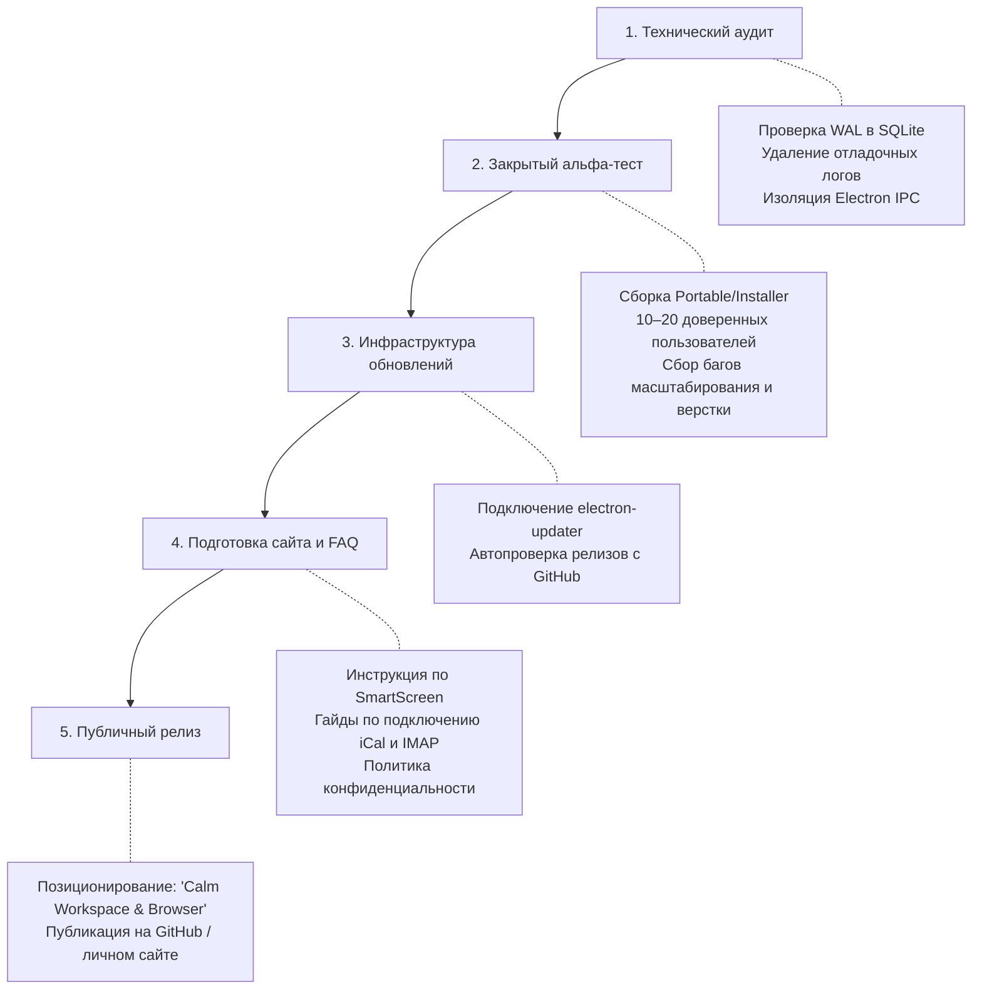

# Руководство по безопасности и подготовке к релизу («Дом» / dombro)

> **Назначение:** Практический справочник для соло-создателя и дизайнера по выпуску бесплатного настольного браузера-дашборда в публичный продакшен без корпоративных бюджетов, с соблюдением стандартов безопасности и чистоты архитектуры.

---

## 1. Архитектура данных: почему локальная база (SQLite) — это норма

Хранение базы данных на устройстве пользователя — это не «компромисс для новичков», а современная парадигма **Local-First Software** («Сначала локальные данные»).

### Преимущества подхода
* **0 рублей расходов на серверы:** Приложение не требует аренды PostgreSQL, Redis или кластеров Supabase. 100 000 активных пользователей обходятся в те же \$0, что и 10.
* **Мгновенный интерфейс (Zero Latency):** Чтение из локального SSD занимает менее 1 миллисекунды. Интерфейс работает без спиннеров и скелетонов.
* **Офлайн-доступность:** Дашборд, задачи, история вкладок и заметки доступны без подключения к сети.
* **Приватность и юридическая безопасность:** Вы не собираете и не храните персональные данные на своих серверах, что снимает 95% бюрократических требований GDPR и 152-ФЗ.

### Обязательные требования к надежности SQLite в проде
1. **Включение WAL-режима:**
   ```sql
   PRAGMA journal_mode = WAL;
   PRAGMA synchronous = NORMAL;
   ```
   *Зачем:* Предотвращает повреждение базы при внезапном закрытии процесса или отключении питания, исключает блокировки при одновременном чтении и записи.
2. **Автоматические резервные копии (Rolling Backups):**
   * При каждом запуске или раз в сутки делать снимок файла базы рядом (`dombro.db.backup`).
   * В приложении уже заложена основа через вызов `state:backup`.
3. **Версионирование схемы (Миграции):**
   * Использовать `PRAGMA user_version` для отслеживания версии схемы и накатывания изменений таблиц при обновлениях без потери данных пользователя.

---

## 2. Безопасность браузера (Electron Hardening)

Поскольку приложение отображает произвольные сайты из интернета, защита изоляции процесса является наивысшим приоритетом.

### Уже соблюдено в текущей кодовой базе
* `contextIsolation: true` — скрипты страниц не имеют прямого доступа к контексту Electron.
* `sandbox: true` — процессы рендеринга изолированы в песочнице операционной системы.
* `nodeIntegration: false` — сайты не могут вызывать системные функции Node.js.
* Шифрование секретов (`Vault`) через нативный `safeStorage` (Windows DPAPI / macOS Keychain).

### Что обязательно закрыть перед публичным релизом
> **Статус:** пункты 1–3 и 5 реализованы (только `http/https` во вкладках, отказ при ошибках сертификата, белый список разрешений с вопросом пользователю, Dependabot + CI для Electron). Актуальная модель и открытые риски — в [`security.md`](security.md), выпуск и обновления — в [`release-and-updates.md`](release-and-updates.md). Пункт 4 (общие cookies пространств) не менялся: все пространства делят одну сессию браузера.

1. **Жесткая фильтрация схем URL:**
   * Блокировать переход на протоколы `file://`, `javascript:`, а также кастомные системные протоколы ОС (`ms-msdt:`, `calc:`, `steam:` и т.д.).
   * Разрешать только `https:`, `http:` и явно зарегистрированные внутренние схемы.
2. **Обработка SSL-ошибок (`certificate-error`):**
   * По умолчанию не глушить ошибки недействительных, просроченных или поддельных SSL-сертификатов.
   * Предупреждать пользователя об опасности перехвата трафика (Man-in-the-Middle).
3. **Минимизация разрешений сайтов (Permissions):**
   * В `setPermissionRequestHandler` по умолчанию отклонять опасные API: WebUSB, WebBluetooth, File System Access API, захват экрана.
   * Запрашивать диалогом только критически необходимые: микрофон, камера, геолокация, буфер обмена.
4. **Контекст сессий (Partitions & Cookies):**
   * Четко зафиксировать архитектуру: делят ли разные пространства одни и те же куки (один профиль авторизации) или изолированы.
   * Прозрачно отразить это в интерфейсе.
5. **Актуализация движка (0-day уязвимости):**
   * Движок Chromium регулярно закрывает критические уязвимости (RCE).
   * Релиз нельзя оставлять «застывшим»: приложение должно регулярно пересобираться со свежими версиями Electron.

---

## 3. Встроенный менеджер паролей и история (Local Vault & History)

Вместо зависимости от сторонних облачных расширений или платных сервисов, в браузере реализована встроенная, полностью локальная система хранения чувствительных данных:

### Менеджер паролей (Local Vault)
1. **Аппаратное шифрование (OS-level safeStorage):**
   * Все учетные данные (логины, пароли, домены) шифруются через криптографические механизмы ОС:
     * **Windows:** Windows Data Protection API (DPAPI) с привязкой к учетной записи пользователя.
     * **macOS:** Apple Keychain.
     * **Linux:** Secret Service API / libsecret.
   * Никакие пароли не сохраняются в открытом виде (plaintext) в файлах настроек или в SQLite.
2. **Изоляция и перехват форм:**
   * Страницы сайтов не имеют прямого доступа к хранилищу паролей.
   * При отправке форм авторизации (`submit`) изолированный preload-скрипт определяет ввод логина/пароля и отправляет системный сигнал в доверенный контур Electron.
   * Приложение отображает аккуратный стеклянный запрос на сохранение без навязчивых всплывающих окон.
3. **Управление и миграция:**
   * Просмотр сохраненных логинов, скрытие/показ паролей, быстрое копирование в буфер и удаление в разделе `Настройки -> Безопасность -> Пароли`.
   * Встроенный импорт паролей из Google Chrome и стандартного формата CSV для легкого перехода.

### История просмотров (Local-First History)
* **Приватность:** История посещенных сайтов хранится исключительно в локальной базе данных `dom.sqlite` на диске пользователя.
* **Группировка и поиск:** Мгновенный поиск по заголовку и URL, разбивка по временным отрезкам (Сегодня, Вчера, На этой неделе, Ранее).
* **Горячие клавиши:** Быстрый вызов через `Ctrl+H` (`Cmd+Y`), интеграция в верхнюю панель навигации и контекстные меню без визуального шума.
* **Управление:** Возможность быстро удалить отдельную запись или полностью очистить историю в один клик.

---

## 4. Интеграции: Почта и Календарь (Безопасно, бесплатно, продово)

### Календари: Протокол iCal / WebCal
* **Почему не нужен облачный OAuth:** Все ключевые сервисы (Google Календарь, Apple iCloud, Яндекс, Outlook) предоставляют *секретный URL подписки* в формате `.ics`.
* **Архитектура:** Приложение напрямую с машины пользователя опрашивает этот адрес через HTTPS и парсит данные (`ical.js`). Адрес шифруется локально через `safeStorage`.
* **UX-решение («Не стыдно»):**
  * Красивый визард подключения: выбор провайдера $\rightarrow$ 3 понятных шага со скриншотами $\rightarrow$ вставка ссылки.
  * Для сценария рабочего дашборда (показать расписание на день, ближайший созвон) это покрывает 100% потребностей без серверов и затрат.

### Почта: IMAP + Пароли приложений (App Passwords)
* **Барьер Google OAuth:** Прямой доступ к письмам через API Google (`gmail.readonly`) требует прохождения платной верификации безопасности (CASA Tier 2/3), стоимость которой составляет от \$1,500 до \$15,000 в год.
* **Решение:** Подключение через стандартный протокол **IMAP** (например, библиотека `imapflow`):
  * Пользователь использует **«Пароль приложения»** (App Password), который генерируется в настройках безопасности Google/Яндекс/Apple/Mail.ru.
  * Это стандарт для независимых клиентов (Thunderbird, Mailspring).
  * 16-значный пароль сохраняется в локальном `safeStorage`.
  * Никаких внешних серверов, нулевые расходы, полная приватность (письма читаются напрямую).

### ИИ (AI-ассистент)
* Использовать модель **BYOK (Bring Your Own Key)**: пользователь вводит собственный ключ OpenAI / Anthropic.
* Ключи шифруются через `safeStorage`.
* Это избавляет проект от риска получить гигантский счет за чужие токены.

---

## 5. Платформенные вызовы настольного релиза

### 1. Как убрать синий экран Windows SmartScreen без сертификата за $500
* **Проблема:** Неподписанный `.exe` при первом запуске вызывает блокирующий экран: *«Система Windows защитила ваш компьютер»*. Обычный OV-сертификат больше не спасает от SmartScreen на Windows 11, а классический аппаратный EV-токен на USB стоит \$400–\$600/год и неудобен для CI/CD.
* **Современные доступные решения для dombro:**

| Вариант | Стоимость | Как внедрить в dombro |
| :--- | :--- | :--- |
| **Azure Trusted Signing** *(рекомендуется)* | ~\$9.99 / мес. | Официальная облачная подпись от Microsoft Identity Verification. Мгновенно формирует доверие SmartScreen на Windows 11 и подключается плагином к `electron-builder` без физических токенов. |
| **Microsoft Store (MSIX)** | \$19 (единоразово) | При публикации пакета через Microsoft Partner Center корпорация Microsoft сама подписывает бинарник своим доверенным сертификатом. Пользователи скачивают браузер без единого предупреждения безопасности. |
| **SignPath.io** | Бесплатно (Open Source) | Если проект или его сборка вынесены в публичный репозиторий GitHub, SignPath предоставляет бесплатный облачный сертификат подписи кода через доверенный GitHub Actions пайплайн. |

### 2. Поддержка Widevine DRM (Spotify, Netflix, Кинопоиск)
Стандартная сборка Electron не содержит подписанного Google Widevine CDM модуля, поэтому лицензионные медиапотоки выдают ошибку воспроизведения.

* **Архитектура интеграции:**
  1. **Переход на сборку `@castlabs/electron-releases`:** В `package.json` стандартный пакет `electron` заменяется на форк Castlabs, поддерживающий Widevine CDM и Verified Media Path (VMP).
  2. **Инициализация компонентов на старте:** В `electron/main.cjs` перед запуском окон и `BrowserManager` вызывается:
     ```javascript
     if (components && typeof components.whenReady === 'function') {
       await components.whenReady();
     }
     ```
  3. **Подпись бинарников через Castlabs EVS:** Для прохождения VMP-проверок защищенных сервисов регистрируется бесплатный аккаунт в Castlabs EVS и запускается шаг подписи (`python -m castlabs_evs.vmp sign-pkg`) перед упаковкой `electron-builder`.

### 3. Совместимость с Google Auth и Cloudflare Turnstile (Антидетект Chromium)
По умолчанию скрипты защиты Google и капчи Cloudflare блокируют Electron из-за флагов автоматизации и специфических заголовков:
* **Отключение флага автоматизации Blink:** Вызов `app.commandLine.appendSwitch('disable-blink-features', 'AutomationControlled')` на старте процесса скрывает признак автоматизированного управления.
* **Синхронизация Client Hints (Sec-CH-UA):** В `session.webRequest.onBeforeSendHeaders` заголовки `Sec-CH-UA` и `Sec-CH-UA-Full-Version-List` динамически заменяются на бренд `"Google Chrome"` с мажорной и полной версией текущего движка Chromium (`process.versions.chrome`), а сигнатуры `Electron/...` удаляются из `User-Agent`.
* **Очистка `navigator.webdriver`:** В `electron/page-preload.cjs` свойство `navigator.webdriver` переопределяется через `Object.defineProperty` на возврат `false` как в контексте прелоада, так и внедрением в основной DOM страницы.
* **Резервный вход (OAuth Fallback):** Для сервисов со строгими политиками Webview в `BrowserPane.tsx` предусмотрена кнопка «В браузере» (`onOpenExternal`), передающая авторизационный поток в системный браузер по умолчанию.

### 4. macOS Gatekeeper и Notarization
* На macOS неподписанные файлы блокируются жестко (*«Файл поврежден»*).
* Для официального релиза под Mac потребуется подписка Apple Developer (\$99/год) и автоматическая нотаризация через `electron-notarize`.

### 5. Проблемы с «железом» у пользователей
* **Масштаб экранов (HiDPI):** На Windows при масштабе 125%/150% координаты плавающих вкладок могут сдвигаться на 1 пиксель. Требуется тестирование с учетом коэффициента масштабирования дисплея.
* **Черные экраны (GPU):** Предусмотреть запуск с флагом `--disable-gpu` для старых видеокарт.

---

## 6. Юридическая прозрачность и приватность

Опубликовать на лендинге и в репозитории два базовых документа:

1. **Privacy Policy (Политика конфиденциальности):**
   * Акцентировать внимание на Local-First: *«Мы не храним вашу историю, вкладки, задачи и пароли на удаленных серверах. Все данные обрабатываются локально на вашем устройстве»*.
2. **Terms of Service (Пользовательское соглашение):**
   * Стандартный пункт об ограничении ответственности («AS IS / Как есть»).

---

## 7. Пошаговый чеклист выхода в прод



### Главный совет по позиционированию
Не позиционировать продукт как «убийцу Google Chrome». Пользователи ждут от Chrome десятков тысяч расширений и кроссплатформенной синхронизации. 

Позиционирование **«Спокойный рабочий дашборд и фокус-браузер для жизни и работы»** привлекает целевую аудиторию, формирует адекватные ожидания и подчеркивает уникальный дизайн и сценарии «Дома».
