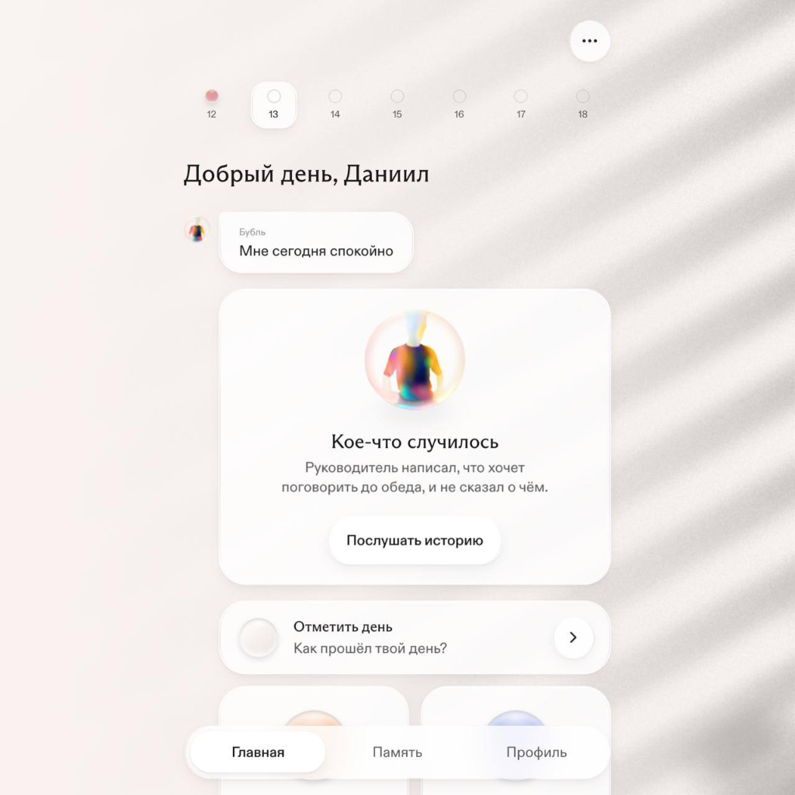

# Техническая спецификация: Фотореалистичный анимированный оверлей теней (Жалюзи + Растение) для Calm-фона

> **Назначение документа:** Полное руководство и техническое задание для 3D-моделлеров, аниматоров и разработчиков (включая передачу специализированным ИИ-ассистентам) для создания и интеграции фотореалистичного живого фона в архитектуру dombro.

---

## 1. Концепция и визуальный референс

### Цель
Создать минималистичный, тактильный и живой фон рабочего пространства в духе **Calm Tech**: однотонная теплая текстурированная стена (штукатурка / алебастр / известняк), на которую падает мягкий утренний свет из окна сквозь жалюзи и ветви комнатного растения. Ветерок за окном слегка шевелит жалюзи и листья с естественной, физически корректной нерегулярностью.

### Визуальный референс
Ниже представлен целевой стиль освещения, контраста и геометрии теней:



---

## 2. Физика света и требования к реализму

Чтобы тень выглядела естественно и не создавала визуального утомления:

1. **Прогрессивная полутень (Penumbra / Contact Hardening):**
   * Тень **не должна быть равномерно размыта по всему кадру**.
   * Чем ближе объект к стене, тем четче граница тени (~6–10px размытия).
   * По мере удаления объекта от плоскости стены (дальние края ламелей жалюзи, выступающие вперед кончики листьев) тень обязана плавно рассеиваться и становиться мягкой (~30–60px размытия).
2. **Геометрия и глубина:**
   * Диагональный угол падения света: 35°–45° сверху справа налево вниз (создает естественную диагональную динамику для взгляда).
   * Ламели жалюзи должны иметь легкий изгиб профиля, давая плавный градиент затенения внутри каждой полосы.
   * Растение (например, ветка эвкалипта, фикуса или пальмы) не должно загромождать кадр: оно деликатно выступает из угла/края кадра, создавая воздушную рамку.
3. **Органическая кинематика ветра:**
   * **Никаких строгих синусоид:** движение должно использовать фрактальный шум (Perlin/Simplex turbulence).
   * **Разделение инертности:**
     * Листья колеблются с более высокой частотой, но мягкой амплитудой (индивидуальное отклонение черешков).
     * Жалюзи колышутся как единая более тяжелая система — с очень низкой частотой и микро-скручиванием ламелей.
   * **Бесшовный цикл (Seamless Loop):** продолжительность цикла 20–30 секунд, без видимых скачков, рывков или повторяющихся паттернов.

---

## 3. Архитектура интеграции: Двухслойный сэндвич

Для масштабируемости и чистоты визуала фон **разделяется на два слоя**:

```
┌─────────────────────────────────────────────────────────────┐
│ 3. UI Слой: Карточки, поиск, типографика (Glassmorphism)    │
├─────────────────────────────────────────────────────────────┤
│ 2. Слой Тени: WebM видео в режиме mix-blend-mode: multiply  │
│    (Черно-белая анимированная карта теней)                  │
├─────────────────────────────────────────────────────────────┤
│ 1. Базовый слой: CSS-цвет стены + микротекстура штукатурки  │
└─────────────────────────────────────────────────────────────┘
```

### Преимущества разделения:
* **Универсальность:** Одна и та же тень может лежать на песочном, оливковом, дымчато-сером или пудровом фоне без перерендера видео.
* **Отсутствие артефактов компрессии:** Стены без цветового бандинга (градиент генерируется CSS, а микро-шум накладывается как легкий паттерн).
* **Магия Multiply:** На чистом белом фоне (`#ffffff`) тени в режиме `multiply` математически затемняют подложку, автоматически принимая истинный оттенок стены.

---

## 4. Пайплайн сборки в Blender 4.x / 5.x

### 4.1. Настройка сцены
1. **Камера:**
   * Тип: `Orthographic` (или `Perspective` с фокусным расстоянием 85–100 мм для устранения геометрических дисторсий).
   * Расположение: Направлена строго перпендикулярно стене (по оси Z или Y).
   * Разрешение: `1920 × 1080` (или `2560 × 1440` для 2K).
   * Частота кадров: `30 fps`. Длина анимации: `600–900 кадров` (20–30 секунд).
2. **Стена-фон (Wall Plane):**
   * Обычная плоскость `Plane` с материалом `Principled BSDF`:
     * Base Color: `#FFFFFF` (чистый белый).
     * Roughness: `1.0` (полностью матовая поверхность без бликов).
     * Specular: `0.0`.

### 4.2. Геометрия жалюзи и растения
1. **Жалюзи (Blinds):**
   * Ряд параллельных изогнутых пластин (Array Modifier).
   * Угол поворота ламелей: ~45°.
   * Дистанция от стены: $Z_1 \approx 0.8\text{ м} – 1.2\text{ м}$.
2. **Ветка растения (Foliage):**
   * Модель реалистичной ветки (Quixel Megascans / Botaniq / кастомная модель).
   * Листья на тонких черешках.
   * Дистанция от стены: $Z_2 \approx 0.3\text{ м} – 0.7\text{ м}$ (ближе к стене, чем жалюзи, чтобы тень листьев была более четкой).

### 4.3. Освещение и полутень (Physically Based Sun Light)
1. **Источник света:**
   * Тип: `Sun Light` (или мощный `Area Light` большого размера за пределами кадра).
   * **Ключевой параметр:** `Angle` (Угловой размер солнца).
   * Установи значение `Angle: 3.5° – 5.5°`. Это заставит лучи расходиться, формируя физически честную прогрессивную полутень (мягкие края на дальних объектах и более резкие на ближних).
   * Цвет света: `#FFFFFF`, сила `Strength: 5.0 – 8.0`.

### 4.4. Анимация ветра и зацикливание
1. **Анимация листьев:**
   * Использовать модификатор `Displace` с текстурой `Clouds` / `Perlin`, привязанный к координатам движущейся пустышки (`Empty`), **ЛИБО**
   * Оснастить ветку скелетом (Bones) и применить модификаторы колебаний с фазовым сдвигом (Wiggle / Noise F-Curve), **ЛИБО**
   * Симуляция ткани/мягкого тела (`Cloth / Soft Body` с пиннингом основания) под воздействием `Force Field (Wind)` + `Force Field (Turbulence)` с параметром `Flow: 0.5 – 1.0`.
2. **Анимация жалюзи:**
   * Модификатор `Simple Deform` (Bend) или `Lattice` с медленной шумовой F-кривой для создания эффекта едва заметного движения воздуха.
3. **Бесшовное зацикливание (Seamless Loop):**
   * Способ A: Зациклить F-кривые шума через `Make Cycles` в Graph Editor.
   * Способ B (универсальный): Просчитать анимацию на 5 секунд длиннее, затем в Blender Compositor или NLE наложить первые 5 секунд внахлест на последние 5 секунд с линейным кроссфейдом прозрачности.

### 4.5. Настройки рендера
* **Движок:** `Cycles` (для абсолютно честной трассировки лучей и мягких теней).
* **Сэмплы:** 64–128 сэмплов с включенным денойзером `OpenImageDenoise` (так как текстур нет, сглаживание шума происходит мгновенно).
* **Формат вывода:** Черно-белая секвенция PNG 8-bit (или 16-bit) в цветовом пространстве Standard / sRGB.

---

## 5. Пост-обработка и конвертация в WebM

Для получения минимального веса файла при 1080p/30fps:

### 5.1. Зацикливание через FFmpeg (если не сделано в 3D)
Если исходник длится 25 секунд, а цикл делаем на 20 секунд с 5-секундным нахлестом:
```bash
ffmpeg -i raw_shadow.mp4 -filter_complex \
"[0:v]split[v1][v2]; \
 [v1]trim=0:20,setpts=PTS-STARTPTS[base]; \
 [v2]trim=20:25,setpts=PTS-STARTPTS[overlap]; \
 [base][overlap]xfade=transition=fade:duration=5:offset=15[out]" \
-map "[out]" loop_shadow.mp4
```

### 5.2. Сжатие в ультра-легкий WebM (VP9)
```bash
ffmpeg -i loop_shadow.mp4 -c:v libvpx-vp9 \
  -b:v 0 -crf 34 \
  -pix_fmt yuv420p \
  -an \
  -quality good -speed 2 \
  -tile-columns 2 -frame-parallel 1 \
  shadow-overlay.webm
```
*Ожидаемый вес:* **~800 КБ – 1.4 МБ** на 25 секунд видео при 1080p.

### 5.3. Создание постера первого кадра (для reduced-motion и fallback)
```bash
ffmpeg -i shadow-overlay.webm -vframes 1 -q:v 2 shadow-poster.webp
```

---

## 6. Фронтенд-интеграция в проект

### 6.1. CSS Стили
```css
/* Базовый контейнер приложения */
.app-shell {
  position: relative;
  width: 100vw;
  height: 100vh;
  overflow: hidden;
  /* Базовая текстура штукатурки и цвет */
  background-color: var(--wall-color, #f4efe9);
  background-image: var(--wall-texture, url('/textures/stucco-noise.webp'));
  background-repeat: repeat;
  background-size: 512px 512px;
}

/* Контейнер видео-оверлея */
.shadow-overlay-container {
  position: absolute;
  inset: 0;
  width: 100%;
  height: 100%;
  pointer-events: none;
  overflow: hidden;
  z-index: 0;
}

/* Видео с эффектом физической тени */
.shadow-overlay-video {
  width: 100%;
  height: 100%;
  object-fit: cover;
  object-position: center center;
  mix-blend-mode: multiply;
  opacity: var(--shadow-intensity, 0.45);
  display: block;
}

/* Учет доступности: при prefers-reduced-motion заменяем видео на статичный постер */
@media (prefers-reduced-motion: reduce) {
  .shadow-overlay-video {
    display: none;
  }
  .shadow-overlay-container {
    background-image: url('/backgrounds/shadow-poster.webp');
    background-size: cover;
    background-position: center center;
    mix-blend-mode: multiply;
    opacity: var(--shadow-intensity, 0.45);
  }
}
```

### 6.2. React-компонент с контролем жизненного цикла
```tsx
import React, { useEffect, useRef } from 'react';

interface ShadowWallpaperProps {
  videoSrc?: string;
  posterSrc?: string;
  intensity?: number; // 0.2 - 0.7
}

export const ShadowWallpaper: React.FC<ShadowWallpaperProps> = ({
  videoSrc = '/backgrounds/shadow-overlay.webm',
  posterSrc = '/backgrounds/shadow-poster.webp',
  intensity = 0.45,
}) => {
  const videoRef = useRef<HTMLVideoElement>(null);

  useEffect(() => {
    const video = videoRef.current;
    if (!video) return;

    // Энергоэффективность: пауза при скрытии окна или сворачивании
    const handleVisibility = () => {
      if (document.hidden) {
        video.pause();
      } else {
        video.play().catch(() => {});
      }
    };

    document.addEventListener('visibilitychange', handleVisibility);
    return () => document.removeEventListener('visibilitychange', handleVisibility);
  }, []);

  return (
    <div 
      className="shadow-overlay-container" 
      style={{ '--shadow-intensity': intensity } as React.CSSProperties}
    >
      <video
        ref={videoRef}
        className="shadow-overlay-video"
        src={videoSrc}
        poster={posterSrc}
        autoPlay
        loop
        muted
        playsInline
      />
    </div>
  );
};
```

---

## 7. Чек-лист проверки качества (Acceptance Criteria)

Перед сдачей готового фона в релиз проверьте следующие пункты:

* [ ] **Реализм полутени:** Контуры тени ближе к объекту четкие, дальние края — естественно рассеянные.
* [ ] **Чистый белый цвет фона:** Фон видео абсолютно белый (`#FFFFFF`). Любой паразитный серый оттенок на фоне вызовет затемнение всего экрана в режиме multiply.
* [ ] **Отсутствие шва (Seamless):** При переходе с последнего кадра на первый отсутствует видимый рывок, скачок света или изменение формы листьев.
* [ ] **Производительность:** Нагрузка на CPU при непрерывном воспроизведении составляет 0%, воспроизведение идет на выделенном аппаратном декодере GPU.
* [ ] **Пауза в фоне:** При минимизации приложения или переключении на другое окно декодер видео приостанавливается.
* [ ] **Доступность:** При включенном `prefers-reduced-motion` видео не проигрывается, а отображается статический постер.
* [ ] **Контрастность:** При интенсивности тени по умолчанию (0.4–0.5) весь текст интерфейса и карточки остаются легко читаемыми (WCAG AAA).
