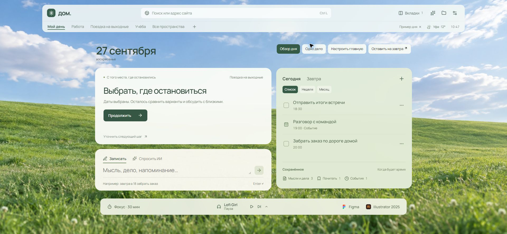

# Проверка Chrome — 27 сентября 2026

Проверялся http://127.0.0.1:5173/?demo=1 через расширение Chrome. Использовались только демонстрационные записи и локальные тестовые источники. После проверки тестовый пример сброшен; личный режим не редактировался. Упаковка Windows после просьбы пользователя не выполнялась.

## Проверено через интерфейс

| Сценарий | Результат |
| --- | --- |
| Поиск «забрать заказ» | Найдено демонстрационное дело; выбор открывает его редактирование |
| Виджеты | Почта и дайджест добавляются; S/M/L меняют ширину; порядок и подробность сохраняются после перезагрузки |
| Скрыть и отменить | Почта возвращается после отмены скрытия |
| Дайджест | Заголовки скрывают фрагменты; подробный режим показывает их; большой размер занимает всю сетку |
| «Одно дело» | Показываются продолжение, одно дело и быстрая запись |
| Закрытый черновик | Текст восстанавливается при повторном открытии |
| Детали черновика | Вручную изменённые название, день и время восстанавливаются после закрытия; даты проверены настоящими клавишами Chrome |
| Быстрый ввод | Несохранённый текст переживает перезагрузку; Enter сохраняет запись |
| Дело «завтра» | Сохраняется без напоминания и показывается в завтрашнем списке |
| Island | Актуальное напоминание появляется; завершение и «Вернуть» изменяют дело и восстанавливают подсказку |
| Завершение дня | Сохраняется следующий шаг; переносится только выбранное дело; отмена возвращает обе части |
| Календарь | Месяц, смена месяца, неделя и возвращение в список работают |
| Клавиатура | Shift + Tab с первого элемента диалога переводит на последний; Tab возвращает на первый; Escape закрывает диалог |
| RSS | Локальная лента qa/fixtures/feed.xml создаёт выпуск с двумя материалами |
| Ошибка RSS | HTML-страница вместо RSS вызывает понятную ошибку; материалы рабочего источника сохраняются |
| Импорт | JSON с 300 вкладками создаёт пространство с 300 вкладками; поиск находит «Страница 300», выбор меняет текущий адрес |
| Переход после импорта | Импорт двух адресов открывает список пространств; карточка созданного пространства сразу открывает его вкладки |
| Фокус | 15 минут запускаются через меню браузера без включения музыки; island позволяет остановить |
| Компактная оболочка | При 1280×720 область страницы — 632 px, заголовок — 88 px; около 88% клиентской высоты |
| Размеры окна | Проверены 1280×720, 960×720, 640×800; горизонтального переполнения документа нет; в узком окне карточки занимают всю доступную ширину |

## Автоматическая проверка

Последний прогон 27 сентября 2026: `npm test` — 47 тестов Vitest в 6 файлах и отдельная проверка SQLite прошли. `npm run build` — TypeScript и веб-ресурсы собраны. `git diff --check` — ошибок нет. Windows-дистрибутив не создавался.

Тесты покрывают миграцию, конкурентные изменения, повреждённое хранилище, резервные копии, дату без таймера, перенос с сохранением срока, календарные повторения/исключения/DST/VTIMEZONE, приоритет внимания, RSS/Atom, импорт и ограничения ИИ. Адаптерные тесты проверяют history 404, сохранение данных другого почтового аккаунта, отсутствие сети, SSE трёх провайдеров, отмену и лимиты.

## Что эта проверка не подтверждает

- Настоящее подключение Gmail, полный OAuth-проход и отзыв доступа на стороне Google.
- Настоящие запросы к моделям по API, качество пересказов и денежную стоимость.
- Встроенный просмотр чужих сайтов в Chrome: он доступен только через Electron.
- Системные уведомления, tray, защиту настоящих форм, cookies, глобальное окно и сочетание записи в текущей веб-приёмке.
- Поведение на реальном Mac, подпись и актуальный Windows-дистрибутив.
- Физическую проверку с включённым уменьшением движения и экранным диктором. CSS-правило реализовано; настройка системы не менялась.

## Снимок проверенной главной

